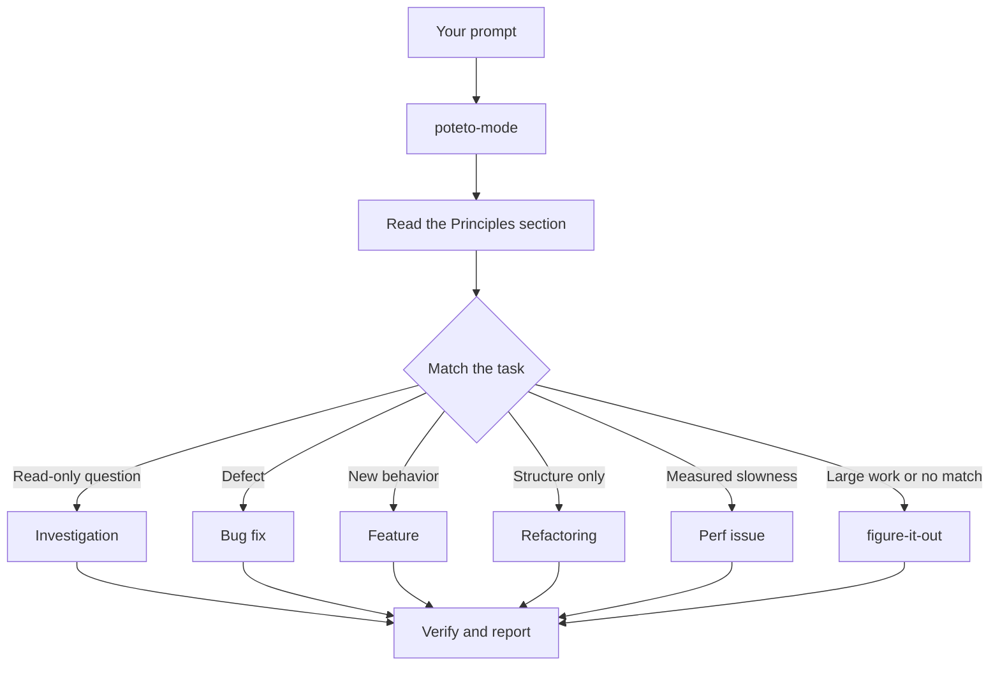
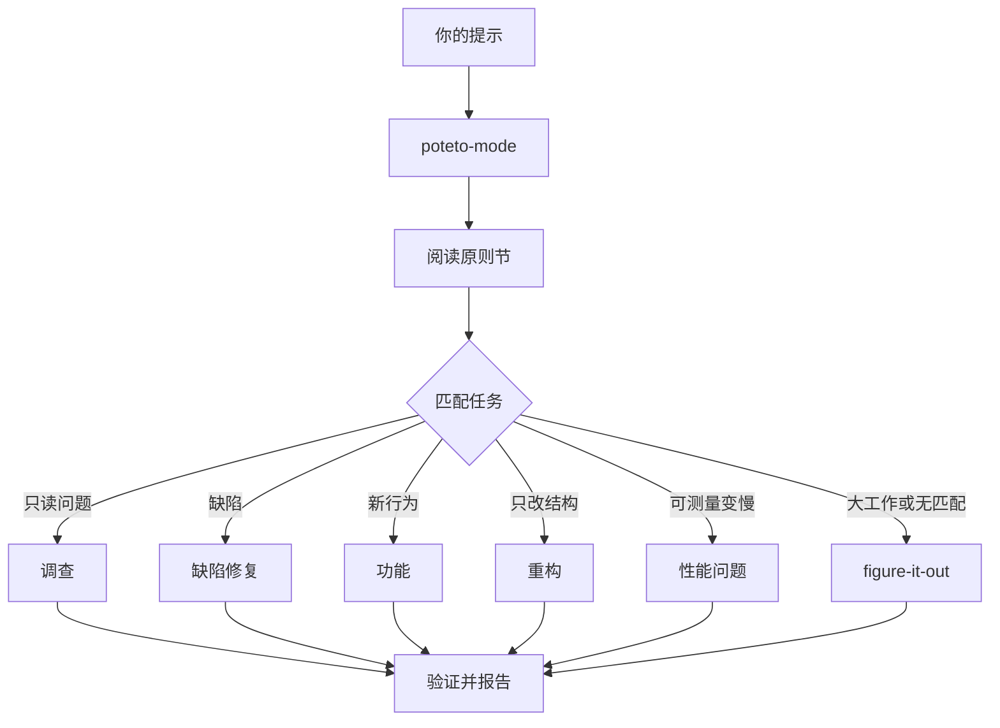

# Route work through `/poteto-mode`

<!-- zh-CN:begin 19da3cf9b0241d05 -->

# 通过 `/poteto-mode` 路由工作

<!-- zh-CN:end 19da3cf9b0241d05 -->

`/poteto-mode` is the front door. You give it a goal, it matches one of twenty-three playbooks, copies that playbook's steps into the todo list, and calls the other skills as the steps need them. In this page you learn what a good prompt looks like, and how little of one you actually need.

<!-- zh-CN:begin 7410ec1f1f1bdad0 -->

`/poteto-mode` 是入口。你给目标，它匹配二十三个操作手册之一，将步骤复制到待办并需要时调用其他技能。本页说明好提示是什么样，以及提示能有多短。

<!-- zh-CN:end 7410ec1f1f1bdad0 -->


<!-- zh-CN:begin 6351ef867682de77 -->


<!-- zh-CN:end 6351ef867682de77 -->

## What happens to your prompt

<!-- zh-CN:begin 73cc21e572cfb2e6 -->

## 提示会被怎样处理

<!-- zh-CN:end 73cc21e572cfb2e6 -->



<!-- zh-CN:begin 5d79bc558a29ed7b -->



<!-- zh-CN:end 5d79bc558a29ed7b -->

The diagram shows the common routes. There are also playbooks for hillclimbing a metric, diagnosing runtime symptoms and captured traces, prototypes, visual parity, authoring and evaluating skills, autonomous runs, opening a PR, babysitting a PR or stack to merge-ready, shipping a verified stack, running a PR queue or a stack on autopilot, orchestrating project-scale programs, session pickup, pausing safely, multi-phase plans, and worktree cleanup. The [playbook directory](../../skills/poteto-mode/playbooks/) has the full set.

<!-- zh-CN:begin f148c5c2c4776891 -->

图示常见路由。另有关于指标爬坡、运行时症状与抓取轨迹诊断、原型、视觉一致性、技能编写评估、自主运行、开 PR、看护 PR/堆叠至可合并、发布已验证堆叠、自动运行 PR 队列/堆叠、项目级项目编排、会话接续、安全暂停、多阶段计划和工作树清理的手册。[手册目录](../../skills/poteto-mode/playbooks/)包含全部。

<!-- zh-CN:end f148c5c2c4776891 -->

## Say the goal, not the ceremony

<!-- zh-CN:begin a25111442129de49 -->

## 说明目标而非仪式

<!-- zh-CN:end a25111442129de49 -->

You don't write a spec. You say what's wrong or what you want, plus anything you already know that saves the agent time:

<!-- zh-CN:begin 7d1136f16c91f225 -->

无需写规格。说明哪里错或想要什么，并补充现有信息：

<!-- zh-CN:end 7d1136f16c91f225 -->

```text
/poteto-mode users get two notifications after a retry. repro first, then fix and verify.
```

<!-- zh-CN:begin 8a536fb753bd6b1d -->

```text
/poteto-mode 用户在重试后收到两个通知。先复现，再修复并验证。
```

<!-- zh-CN:end 8a536fb753bd6b1d -->

That's a Bug fix prompt. "repro first" is a real constraint, not politeness, and the playbook honors it. Watch the todo list fill with the Bug fix steps. A skipped step stays visible with `skip: <reason>`.

<!-- zh-CN:begin ce4aa71f4b3ba660 -->

这是缺陷修复提示。“先复现”是真实约束，操作手册会遵守。观察待办填入修复步骤；跳过步骤仍显示为 `skip: <reason>`。

<!-- zh-CN:end ce4aa71f4b3ba660 -->

## What goes in a prompt

<!-- zh-CN:begin e6e59f94b3e6e6ab -->

## 提示应包含什么

<!-- zh-CN:end e6e59f94b3e6e6ab -->

A useful prompt carries up to five things, and each one fits in a sentence:

<!-- zh-CN:begin e3dfb574694ef0e4 -->

有用提示至多五件事，每项一句：

<!-- zh-CN:end e3dfb574694ef0e4 -->

- **The goal.** Say what's wrong, or what you want.

<!-- zh-CN:begin c6e95f8524108df5 -->

- **目标。** 说明错误或期望。

<!-- zh-CN:end c6e95f8524108df5 -->
- **The done check.** It must be able to pass or fail. "Make it better" and "work on it for an hour" aren't checks.

<!-- zh-CN:begin a1d34a7e96c5eb8c -->

- **完成检查。** 必须能通过或失败；“做得更好”“做一小时”不是检查。

<!-- zh-CN:end a1d34a7e96c5eb8c -->
- **The proof you want to see.** Ask for the real command output, a video of the flow, the stored value, or a before-and-after number.

<!-- zh-CN:begin a01ba2679c5f58a5 -->

- **想看到的证据。** 要求真实命令输出、流程视频、保存值或前后数字。

<!-- zh-CN:end a01ba2679c5f58a5 -->
- **What you already know.** A symptom, a repro step, a log line, or a link saves the agent a search.

<!-- zh-CN:begin 59434b0b895d52e1 -->

- **已知内容。** 症状、复现步骤、日志行或链接可省搜索。

<!-- zh-CN:end 59434b0b895d52e1 -->
- **The real constraints.** "repro first", "don't change any code yet", "zero behavior change", and "let me review before proceeding" each change what the agent does.

<!-- zh-CN:begin ca9159a8f2302adb -->

- **真实约束。** “先复现”“暂不改代码”“行为零变化”“继续前先让我审查”都会改变行为。

<!-- zh-CN:end ca9159a8f2302adb -->

Here's one prompt with all five:

<!-- zh-CN:begin 5cb65fd35face536 -->

以下提示包含五项：

<!-- zh-CN:end 5cb65fd35face536 -->

```text
/poteto-mode the csv export drops its last row since yesterday's deploy. failing job id is 4812. repro first, then fix. done means the 60k-row fixture exports every row. show me the row counts before and after.
```

<!-- zh-CN:begin 760542a447b067d7 -->

```text
/poteto-mode 自昨天部署后，CSV 导出丢失最后一行。失败作业 ID 是 4812。先复现再修复。完成指 6 万行夹具导出所有行。显示前后行数。
```

<!-- zh-CN:end 760542a447b067d7 -->

Two things are worth leaving out:

<!-- zh-CN:begin a983cd164369d116 -->

两件事应省略：

<!-- zh-CN:end a983cd164369d116 -->

- **The how.** Say what to achieve, and leave the agent room to find a better path than the one you'd pick. The same goes for a list of skills, covered in the pitfall below.

<!-- zh-CN:begin 36cd94c2c4425206 -->

- **怎样做。** 说结果，让代理寻找更好路径；也不要列技能清单，见下方陷阱。

<!-- zh-CN:end 36cd94c2c4425206 -->
- **Your theory of the cause, at first.** A stated guess narrows the search to wherever you pointed. Let the agent restate the problem before you share your hunch.

<!-- zh-CN:begin db4146d3015b25fc -->

- **你对原因的猜测。** 早说会缩窄搜索。让代理先复述问题，再分享直觉。

<!-- zh-CN:end db4146d3015b25fc -->

For a noisy report, such as a long thread or a vague bug, make the restatement the first step:

<!-- zh-CN:begin 80d631bd7262a474 -->

报告嘈杂（长线程或含糊缺陷）时，把复述作为第一步：

<!-- zh-CN:end 80d631bd7262a474 -->

```text
/poteto-mode read this thread. restate the underlying issue in your own words, in plain english. don't change any code yet.
```

<!-- zh-CN:begin f18adfe9943820b8 -->

```text
/poteto-mode 阅读此线程。用平实中文说出底层问题。暂不改代码。
```

<!-- zh-CN:end f18adfe9943820b8 -->

A misreading shows up in the restatement, before any code exists. Correct it there, and it costs you one message instead of one wrong fix. For the restatement alone, with no playbook, run [`/in-your-own-words`](../../skills/in-your-own-words/SKILL.md). It restates what the agent thinks your goals are and what problem you're trying to solve.

<!-- zh-CN:begin 792061d19c1471e3 -->

误读会先在复述中暴露，修成本只需一条消息而非一次错误修复。仅复述而不走手册可用 [`/in-your-own-words`](../../skills/in-your-own-words/SKILL.md)，它会说出代理理解的目标和问题。

<!-- zh-CN:end 792061d19c1471e3 -->

When you're unsure whether a prompt is aimed right, run [`/sharpen`](../../skills/sharpen/SKILL.md) on it before you send it:

<!-- zh-CN:begin 52955e8a54cf1d31 -->

不确定提示方向时，发送前运行 [`/sharpen`](../../skills/sharpen/SKILL.md)：

<!-- zh-CN:end 52955e8a54cf1d31 -->

```text
/sharpen write a migration guide for the v2 config format.
```

<!-- zh-CN:begin 77caa6012aab74d2 -->

```text
/sharpen 为 v2 配置格式写迁移指南。
```

<!-- zh-CN:end 77caa6012aab74d2 -->

The agent says what a top professional would do that you didn't ask for, the rawest material they would start from, the methods and tools they would use, and what other than you or the agent would show the result is right. Then it rewrites your prompt to ask for exactly that, deeper but not bigger, and leaves your choices open. It doesn't do the task. Read the rewrite, then send it, for example with `/poteto-mode`.

<!-- zh-CN:begin 596edef7a6ab51e6 -->

代理会说明顶尖专业人员会做而你没要求的事、最原始材料、方法和工具、以及除你或代理外如何证明结果正确；再重写提示，使其更深而不更大，同时保留你的选择。它不执行任务。阅读后发送，例如交给 `/poteto-mode`。

<!-- zh-CN:end 596edef7a6ab51e6 -->

## Follow up short

<!-- zh-CN:begin 55e58f623a314309 -->

## 简短追问

<!-- zh-CN:end 55e58f623a314309 -->

When the conversation already carries the context, the prompt shrinks to almost nothing. All of these are enough:

<!-- zh-CN:begin a671b7de50a47c82 -->

对话已有上下文时，提示几乎可省略。以下足够：

<!-- zh-CN:end a671b7de50a47c82 -->

```text
/poteto-mode do it
```

<!-- zh-CN:begin 325ed1774d7ffdae -->

```text
/poteto-mode 做它
```

<!-- zh-CN:end 325ed1774d7ffdae -->

```text
continue
```

<!-- zh-CN:begin ef26d01a22204b0c -->

```text
继续
```

<!-- zh-CN:end ef26d01a22204b0c -->

```text
keep going until done
```

<!-- zh-CN:begin d5064c684d07ce03 -->

```text
一直做到完成
```

<!-- zh-CN:end d5064c684d07ce03 -->

Short works because the playbook holds the structure, and a Custom Mode keeps `/poteto-mode` in context on every turn. [Set up pstack](./01-setup.md#run-your-first-task) shows how to start one. Your words carry the intent, and the skill carries the rigor.

<!-- zh-CN:begin c0262cd73bf97185 -->

简短有效因为手册保存结构，自定义模式使 `/poteto-mode` 每轮都在上下文。[设置 pstack](./01-setup.md#run-your-first-task)说明如何启动。你的话表达意图，技能提供严格性。

<!-- zh-CN:end c0262cd73bf97185 -->

## Switch tasks with "new task"

<!-- zh-CN:begin 7e20dc43eab54736 -->

## 用“new task”切换任务

<!-- zh-CN:end 7e20dc43eab54736 -->

A long chat accumulates context from the last task. When you change subjects, say so:

<!-- zh-CN:begin 03e052a45c95a423 -->

长对话累积上次上下文。换主题时说明：

<!-- zh-CN:end 03e052a45c95a423 -->

```text
/poteto-mode new task. figure out why the cache entry survives logout. don't change any code yet.
```

<!-- zh-CN:begin fee678182560e9e7 -->

```text
/poteto-mode new task. 找出缓存项为何在退出登录后仍存在。暂不改代码。
```

<!-- zh-CN:end fee678182560e9e7 -->

"new task" tells `/poteto-mode` to re-match rather than continue the prior playbook. "don't change any code yet" pins this one to Investigation. Without those two phrases, a mode mid-Feature tends to treat your question as the next feature step.

<!-- zh-CN:begin d4c74f78f01bd1a2 -->

“new task”让 `/poteto-mode` 重新匹配而非继续旧手册。“暂不改代码”固定为调查。否则处于功能模式时可能把问题当下一功能步骤。

<!-- zh-CN:end d4c74f78f01bd1a2 -->

## Give parallel work its own machine

<!-- zh-CN:begin 7c212aa374d0c08e -->

## 并行工作各用机器

<!-- zh-CN:end 7c212aa374d0c08e -->

If you run several agents against one repository on one computer, they will fight over the working tree, the ports, and the build output. The cleanest isolation is a [cloud subagent](https://cursor.com/docs/subagents#cloud-subagents). Each one gets its own VM and branch, so it can install dependencies, run your app, and record video of the result without touching your machine. Type `/in-cloud` before the task, or ask the parent chat to hand work to cloud subagents.

<!-- zh-CN:begin 5b2ee45c2f8a7bce -->

同一电脑多个代理操作一个仓库会争用工作树、端口和构建输出。最干净隔离是[云子代理](https://cursor.com/docs/subagents#cloud-subagents)，各自 VM 和分支，可安装、运行、录屏而不碰本机。任务前输入 `/in-cloud`，或让父对话交云端。

<!-- zh-CN:end 5b2ee45c2f8a7bce -->

When the work has to stay local, ask for a worktree up front:

<!-- zh-CN:begin 83d26a5c5efaaa41 -->

必须本地时，提前要求工作树：

<!-- zh-CN:end 83d26a5c5efaaa41 -->

```text
/poteto-mode new task. branch off <base> in a fresh worktree, then port the parser change there.
```

<!-- zh-CN:begin dcbdba1f033defc4 -->

```text
/poteto-mode 新任务。在全新工作树中从 <base> 建分支，再移植解析器改动。
```

<!-- zh-CN:end dcbdba1f033defc4 -->

Each task in its own branch and worktree means no agent stomps another's files. Worktrees cost disk and machine resources, so a laptop runs only a handful at once. The [Opening a PR playbook](../../skills/poteto-mode/playbooks/opening-a-pr.md) already works from a worktree for code changes, so mostly you only say this when a specific base or location matters.

<!-- zh-CN:begin 85ca8f53bd86e7a6 -->

每任务独立分支和工作树可避免互相覆盖。工作树耗磁盘和资源，笔记本只宜同时少量。[打开 PR 手册](../../skills/poteto-mode/playbooks/opening-a-pr.md)的代码改动已用工作树，因此只有特定基础或位置重要时才说明。

<!-- zh-CN:end 85ca8f53bd86e7a6 -->

Worktrees accumulate. When disk gets tight, ask:

<!-- zh-CN:begin c307204f1f0034b9 -->

工作树会累积。空间紧张时：

<!-- zh-CN:end c307204f1f0034b9 -->

```text
/poteto-mode what's eating my disk? prune the worktrees that are safe to prune.
```

<!-- zh-CN:begin 8dbc961ec56320c6 -->

```text
/poteto-mode 什么占用了磁盘？清理可安全清理的工作树。
```

<!-- zh-CN:end 8dbc961ec56320c6 -->

The [Worktree cleanup playbook](../../skills/poteto-mode/playbooks/worktree-cleanup.md) classifies every worktree by merge state, uncommitted work, and which chats still touch it. It deletes only what that evidence clears and pauses for your call on anything holding uncommitted work.

<!-- zh-CN:begin 5ce0c46498a2ed3e -->

[工作树清理手册](../../skills/poteto-mode/playbooks/worktree-cleanup.md)按合并状态、未提交工作和仍使用它的聊天分类；只删证据允许项，遇到未提交内容停下等你决定。

<!-- zh-CN:end 5ce0c46498a2ed3e -->

## Leave it running

<!-- zh-CN:begin 439f26dc4f6bf16d -->

## 让它持续运行

<!-- zh-CN:end 439f26dc4f6bf16d -->

When you step away, say what done means and go:

<!-- zh-CN:begin dcbc1b8f95c7492d -->

离开时说明完成条件：

<!-- zh-CN:end dcbc1b8f95c7492d -->

```text
/poteto-mode im stepping away. keep going until the migration check reports zero old callers. log your decisions.
```

<!-- zh-CN:begin 754d74d3e75cf8ca -->

```text
/poteto-mode 我要离开。持续到迁移检查报告旧调用者为零。记录决定。
```

<!-- zh-CN:end 754d74d3e75cf8ca -->

Work you'll review later routes through [`/figure-it-out`](../../skills/figure-it-out/SKILL.md), which designs the run's phases and keeps a [`/show-me-your-work`](../../skills/show-me-your-work/SKILL.md) decision log. [Run work while you sleep](./07-overnight.md) covers the full overnight contract.

<!-- zh-CN:begin ab051fc97786157c -->

稍后审查的工作经 [`/figure-it-out`](../../skills/figure-it-out/SKILL.md) 设计阶段，并保存 [`/show-me-your-work`](../../skills/show-me-your-work/SKILL.md) 决定日志。[睡眠期间运行](./07-overnight.md)说明完整契约。

<!-- zh-CN:end ab051fc97786157c -->

**Pitfall:** don't enumerate skills in your prompt ("use /how, then /architect, then /arena..."). The playbook already sequences them, and a hand-written sequence usually reorders or drops steps the playbook would have kept. Name a skill only when you want to override a specific choice.

<!-- zh-CN:begin cf80cb2a52934c6f -->

**陷阱：** 不要在提示中枚举技能（“先 /how，再 /architect，再 /arena……”）。手册已排序，手写顺序常打乱或漏步。只有要覆盖特定选择时才点名。

<!-- zh-CN:end cf80cb2a52934c6f -->

Read [`poteto-mode`](../../skills/poteto-mode/SKILL.md) itself for the full routing rules.

<!-- zh-CN:begin c5f9a2ff563d7fdb -->

完整路由规则见 [`poteto-mode`](../../skills/poteto-mode/SKILL.md)。

<!-- zh-CN:end c5f9a2ff563d7fdb -->

Next: [Understand the code](./03-understand.md).

<!-- zh-CN:begin a44a80069e71baf7 -->

下一步：[理解代码](./03-understand.md)。

<!-- zh-CN:end a44a80069e71baf7 -->
