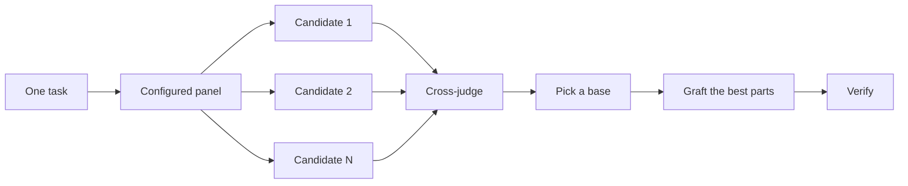
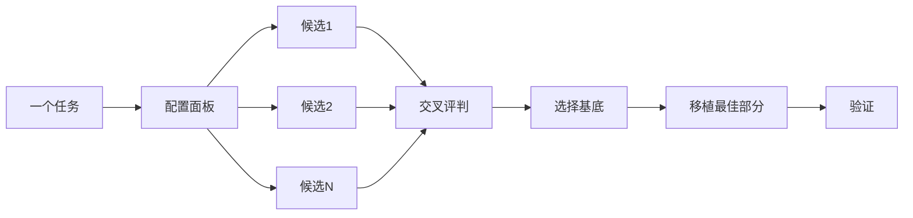

# Design before you write code

<!-- zh-CN:begin 9466459cd301f93a -->

# 写代码前先设计

<!-- zh-CN:end 9466459cd301f93a -->

One attempt at a hard design locks in the first shape the model thought of. `/architect` settles types and boundaries before implementation. `/arena` runs several attempts at the same brief and merges the best parts. `/interrogate` has other models try to break the result. When the job is coverage rather than design synthesis, `/swarm` fans out slices or races and aggregates their results.

<!-- zh-CN:begin 6ae6476378696805 -->

困难设计只尝试一次会锁定模型想到的第一个形状。`/architect`在实施前确定类型和边界；`/arena`对同一简报并行多次并合并最佳部分；`/interrogate`让其他模型尝试攻破结果；任务重在覆盖而非设计综合时，`/swarm`分片或竞速并汇总。

<!-- zh-CN:end 6ae6476378696805 -->

The two most common design mistakes are taking the agent's first design and polishing a plan that no code has tested. This page fixes both. You plan through code. Prototypes answer the open questions, a README or tutorial sets the target, and the written plan comes last.

<!-- zh-CN:begin 9cd4eebfeeb58ec8 -->

两个常见设计错误是采用代理最初设计，以及打磨无人测试的计划。本页解决二者：通过代码规划。原型回答开放问题，README或教程设定目标，书面计划最后写。

<!-- zh-CN:end 9cd4eebfeeb58ec8 -->


<!-- zh-CN:begin 55200d355c8d3075 -->


<!-- zh-CN:end 55200d355c8d3075 -->

## Settle the shape with `/architect`

<!-- zh-CN:begin f07969b66d6c39d4 -->

## 用`/architect`确定形态

<!-- zh-CN:end f07969b66d6c39d4 -->

```text
/architect design the import pipeline before writing any code. i care most about how callers use it.
```

<!-- zh-CN:begin aade3d171643be81 -->

```text
/architect 写代码前设计导入管线，我最关心调用者如何使用。
```

<!-- zh-CN:end aade3d171643be81 -->

[`/architect`](../../skills/architect/SKILL.md) grounds itself first, running `/how` over the code the design touches and `/why` when it moves ownership or layers. Then it runs `/arena` to produce competing design sketches, with the caller's usage written first in each, followed by types, signatures, and a module map.

<!-- zh-CN:begin 751bc7692d09d918 -->

[`/architect`](../../skills/architect/SKILL.md)先用`/how`理解相关代码，所有权或分层变化时用`/why`；随后用`/arena`产生竞争设计草图，每份先写调用者用法，再写类型、签名和模块图。

<!-- zh-CN:end 751bc7692d09d918 -->

By default it proceeds straight from the synthesized design into implementation. If you want to see the design first, say so:

<!-- zh-CN:begin 6a5e6be5d73b45a3 -->

默认综合后直接实施。先看设计要说明：

<!-- zh-CN:end 6a5e6be5d73b45a3 -->

```text
/architect with checkpoint. stop and show me before implementing.
```

<!-- zh-CN:begin 941e06bc8ee13919 -->

```text
/architect 带检查点，实施前停止展示设计。
```

<!-- zh-CN:end 941e06bc8ee13919 -->

The design isn't sacred once code starts. If implementation shows the same workaround in unrelated places, or types that only compile with `any` or forced casts, `/architect` treats that as proof the design is wrong. It scraps the sketch and starts over instead of patching around it.

<!-- zh-CN:begin 0e29aca21507430b -->

代码开始后设计并非神圣。若相同绕过散落无关位置，或类型只能靠`any`/强制转换编译，`/architect`视作设计错误，丢弃草图重来而非打补丁。

<!-- zh-CN:end 0e29aca21507430b -->

## Fan out attempts with `/arena`

<!-- zh-CN:begin 2a9a1492b9021ad6 -->

## 用`/arena`展开尝试

<!-- zh-CN:end 2a9a1492b9021ad6 -->

```text
/arena take my prompt to the arena verbatim. i want to compare their proposals with yours.
```

<!-- zh-CN:begin db32cd798406a73a -->

```text
/arena 把我的提示词原样送去竞技，我想比较他们的方案。
```

<!-- zh-CN:end db32cd798406a73a -->

[`/arena`](../../skills/arena/SKILL.md) is the general tool underneath. N subagents attempt the same design or code brief in parallel, each writing to its own worktree or directory. A read-only judge from a different model family scores every candidate against a rubric. When no model from another family can run, the coordinator skips the judge and picks the base itself. The coordinator reads each candidate end to end, picks a base, grafts in the best ideas from the losers, and verifies the result.

<!-- zh-CN:begin 0616a72ff7dadc45 -->

[`/arena`](../../skills/arena/SKILL.md)是底层通用工具。N个子代理并行尝试同一设计/代码简报，各写独立工作树或目录；不同模型族的只读评判者按标准评分。无其他模型族时协调者自行选择。协调者逐份阅读、选基底、移植落选者最佳思路并验证。

<!-- zh-CN:end 0616a72ff7dadc45 -->



<!-- zh-CN:begin 7547c2335865e114 -->



<!-- zh-CN:end 7547c2335865e114 -->

The panel comes from your [`/setup-pstack`](../../skills/setup-pstack/SKILL.md) configuration, and you can adjust it per task. Ask for more candidates when the decision matters, fewer when it doesn't:

<!-- zh-CN:begin 72df5c5ccd765709 -->

面板来自[`/setup-pstack`](../../skills/setup-pstack/SKILL.md)，可逐任务调整。重要决策多用候选，不重要时少用：

<!-- zh-CN:end 72df5c5ccd765709 -->

```text
/arena this, 5 candidates. the cache key format is expensive to change later.
```

<!-- zh-CN:begin 6a6a5164667077cf -->

```text
/arena 这个任务5个候选，缓存键格式以后很难改。
```

<!-- zh-CN:end 6a6a5164667077cf -->

## Cover slices and races with `/swarm`

<!-- zh-CN:begin 3e52619e195a3da3 -->

## 用`/swarm`覆盖分片和竞速

<!-- zh-CN:end 3e52619e195a3da3 -->

```text
/swarm check every package under packages/ against its check.sh. one worker per package. one report.
```

<!-- zh-CN:begin f0ec850dc5a45ea0 -->

```text
/swarm 对packages/下每个包运行自己的check.sh。每包一个worker，一份报告。
```

<!-- zh-CN:end f0ec850dc5a45ea0 -->

[`/swarm`](../../skills/swarm/SKILL.md) fans N workers across independent slices, coverage matrices, gauntlet lanes, exploration partitions, or declared race arms. Each worker gets its own scope and check, then reports `PASS`, `ISSUES`, or `BLOCKED`. The parent waits for the workers and returns one compact report with any gaps or dropouts.

<!-- zh-CN:begin 08a320a64fe09c9b -->

[`/swarm`](../../skills/swarm/SKILL.md)把N个worker分给独立切片、覆盖矩阵、挑战通道、探索分区或已声明竞速臂；每个有独立范围和检查，报告`PASS`、`ISSUES`或`BLOCKED`。父代理等待并输出含缺口/掉队者的紧凑报告。

<!-- zh-CN:end 08a320a64fe09c9b -->

Reach for it when parallelism buys coverage or lets independent checks race. `/arena` gives every worker the same design or code brief, then picks a base and grafts the best parts. `/swarm` covers slices or runs a race with a selection rule declared up front. It does not use the base-selection and grafting ceremony.

<!-- zh-CN:begin f1cbf7f3d2af2837 -->

并行能增加覆盖或独立检查可竞速时使用。`/arena`让所有worker处理同一简报再选基底；`/swarm`覆盖切片或按预先规则竞速，不使用基底选择仪式。

<!-- zh-CN:end f1cbf7f3d2af2837 -->

## Break it with `/interrogate`

<!-- zh-CN:begin 7494955744a5adac -->

## 用`/interrogate`攻破

<!-- zh-CN:end 7494955744a5adac -->

```text
/interrogate the whole branch, but skeptically. no nitpicks unless it's an actual bug or regression.
```

<!-- zh-CN:begin 856f3e7b5ff50314 -->

```text
/interrogate 审问整个分支，持怀疑态度；除非真实bug或回归，不要挑小毛病。
```

<!-- zh-CN:end 856f3e7b5ff50314 -->

[`/interrogate`](../../skills/interrogate/SKILL.md) gives the change and its intent to adversaries on the configured models, and each tries to break it with a run against the real code. Adversaries find different failures. A finding survives only when rerunning its command shows a failure that breaks the intent. The report lists every verified finding with the adversaries that found it, then what each adversary dropped and why, and applies nothing.

<!-- zh-CN:begin d70be32bc4ea0b24 -->

[`/interrogate`](../../skills/interrogate/SKILL.md)把改动和意图交给配置模型上的对手，对真实代码运行并尝试破坏。不同对手发现不同失败；只有重跑命令证明破坏意图的发现才保留。报告列每个已验证问题、发现者、每个对手丢弃项及原因，不应用任何修改。

<!-- zh-CN:end d70be32bc4ea0b24 -->

Read the Dropped list too. You can override the verdict.

<!-- zh-CN:begin eae01d01b386fd76 -->

也读Dropped列表，你可以推翻结论。

<!-- zh-CN:end eae01d01b386fd76 -->

## Prototype instead of debating

<!-- zh-CN:begin 7b51115a189bbf78 -->

## 用原型取代争论

<!-- zh-CN:end 7b51115a189bbf78 -->

Never take the first design. Ask for a few, and pick from evidence you can see:

<!-- zh-CN:begin 5d14202a1f24e21b -->

不要采用第一份设计，要多个并看证据：

<!-- zh-CN:end 5d14202a1f24e21b -->

```text
/poteto-mode prototype a few options for the new dropdown menu. take screenshots or videos for me to compare.
```

<!-- zh-CN:begin 2593f9ae0f31a9d0 -->

```text
/poteto-mode 为新下拉菜单做几个原型，截图或视频给我比较。
```

<!-- zh-CN:end 2593f9ae0f31a9d0 -->

The [Prototype playbook](../../skills/poteto-mode/playbooks/prototype.md) builds throwaway sketches in a scratch directory, puts the variants behind one switcher, drives each one, and captures screenshots or timings. It also works for behavior and algorithms, not just UI. Prototypes are planning with code. They let the agent answer its own open questions by running something instead of asking you, and they leave room for an option you wouldn't have thought of.

<!-- zh-CN:begin d3bff7b724294580 -->

[原型手册](../../skills/poteto-mode/playbooks/prototype.md)在临时目录构建一次性草图，把变体放在一个切换器后，驱动并捕获截图或耗时。也适用于行为和算法。原型是用代码规划，让代理运行而非询问你，并探索你未曾想到的选项。

<!-- zh-CN:end d3bff7b724294580 -->

The same idea scales up to a real design. Pair `/architect` with prototypes and keep a review gate:

<!-- zh-CN:begin b288b2bee201bfa7 -->

同样可扩展到真实设计，将`/architect`与原型及审查关卡配对：

<!-- zh-CN:end b288b2bee201bfa7 -->

```text
/poteto-mode we need rate limiting for external webhooks. /architect it first, and answer open questions with prototypes. let me review before proceeding.
```

<!-- zh-CN:begin 2ffb0475c1461cd6 -->

```text
/poteto-mode 外部webhook需要限流。先用/architect并让原型回答开放问题，继续前让我审查。
```

<!-- zh-CN:end 2ffb0475c1461cd6 -->

Don't spend adversaries on an abstract plan. `/interrogate` drops every finding a run does not prove, so a plan with no code behind it gives them little to break. Let prototypes settle the questions, then review what got built.

<!-- zh-CN:begin 43b5444be1f154f5 -->

不要把对手用于抽象计划。`/interrogate`会丢弃无运行证明的发现，无代码计划可破坏的少。先让原型回答问题，再审查构建物。

<!-- zh-CN:end 43b5444be1f154f5 -->

## Write the README first for shared code

<!-- zh-CN:begin 5640b1d78f0c6e92 -->

## 共享代码先写README

<!-- zh-CN:end 5640b1d78f0c6e92 -->

For a package or API that other code will use, start with the doc a user would read:

<!-- zh-CN:begin 94645619e4c9f397 -->

其他代码会使用的包或API，先写用户会看的文档：

<!-- zh-CN:end 94645619e4c9f397 -->

```text
/poteto-mode write a tutorial for how i would use the new config package first. then /teach me why it beats the current one.
```

<!-- zh-CN:begin 641a697c6f0a093d -->

```text
/poteto-mode 先写我如何使用新配置包的教程，然后/teach我为什么它优于当前方案。
```

<!-- zh-CN:end 641a697c6f0a093d -->

Writing the tutorial first forces the caller's view. You describe the API to a hypothetical user and work back to the implementation. The doc also becomes a concrete target the agent checks its own work against. Name [`/technical-writing`](../../skills/technical-writing/SKILL.md) when the doc itself matters, so a tutorial stays a tutorial instead of drifting into reference and explanation at once.

<!-- zh-CN:begin e097242c643d913e -->

先写教程迫使从调用者视角出发：向假想用户描述API再回推实现；文档也成为代理自我检查目标。文档本身重要时点名[`/technical-writing`](../../skills/technical-writing/SKILL.md)，免得教程漂成参考和解释混合。

<!-- zh-CN:end e097242c643d913e -->

## Plan after the design settles

<!-- zh-CN:begin 244f0d684c3ca848 -->

## 设计稳定后再规划

<!-- zh-CN:end 244f0d684c3ca848 -->

pstack has no planning skill, on purpose. When you do want a written plan, ask for it once the design is settled:

<!-- zh-CN:begin 9f8942fa70b8882e -->

pstack刻意没有规划技能。确实需要书面计划时，等设计确定后提出：

<!-- zh-CN:end 9f8942fa70b8882e -->

```text
/poteto-mode turn this design into a plan. small verifiable PRs, each with its own verification steps.
```

<!-- zh-CN:begin d0143790125f41cc -->

```text
/poteto-mode 把设计变成计划；小而可验证的PR，每个都有验证步骤。
```

<!-- zh-CN:end d0143790125f41cc -->

The [Multi-phase plan playbook](../../skills/poteto-mode/playbooks/multi-phase-plan.md) settles any remaining open questions by prototype, then writes one section per PR, each ending in proof that the change works. A passing test suite alone doesn't count as that proof. The plan is the deliverable. The playbook doesn't implement it, and it names which execution playbook should run it next.

<!-- zh-CN:begin f5cb072bf96d03ed -->

[多阶段计划手册](../../skills/poteto-mode/playbooks/multi-phase-plan.md)先以原型解决剩余问题，再为每个PR写一节并附有效证明；测试套件通过本身不算证明。计划就是交付物，手册不实施，并命名下一步执行手册。

<!-- zh-CN:end f5cb072bf96d03ed -->

For a migration, state the bar in the prompt:

<!-- zh-CN:begin 1f25052ced47ff71 -->

迁移要在提示中声明标准：

<!-- zh-CN:end 1f25052ced47ff71 -->

```text
/poteto-mode plan the migration of our ui library to the new styling system. small verifiable PRs, each with visual regression checks. the result must match the original exactly, bugs included.
```

<!-- zh-CN:begin b7f2354137767502 -->

```text
/poteto-mode 规划UI库迁到新样式系统；小而可验证的PR，每个有视觉回归检查，结果必须与原版完全一致，包括bug。
```

<!-- zh-CN:end b7f2354137767502 -->

"bugs included" keeps the migration from quietly fixing things on the way, which would make the old and new output impossible to compare. For a project that spans many days, you can commit the plan to the repo for a while so other agents see the work in progress. Delete it when the work lands.

<!-- zh-CN:begin 57fd0c00471edb96 -->

“包括bug”防止迁移顺手修复，导致新旧输出无法比较。跨多天项目可暂时提交计划让其他代理看到进展，完工后删除。

<!-- zh-CN:end 57fd0c00471edb96 -->

## How much design work does a task deserve?

<!-- zh-CN:begin bb070177897c783f -->

## 任务需要多少设计

<!-- zh-CN:end bb070177897c783f -->

You might be wondering whether every change needs this. No. Most changes need none of it. A rough ladder:

<!-- zh-CN:begin 55b3f8a79ab04455 -->

并非每项改动都需要。大多数完全不需要。大致阶梯：

<!-- zh-CN:end 55b3f8a79ab04455 -->

- A small, finished change you're unsure about needs `/interrogate` alone.

<!-- zh-CN:begin e1ac4c6adef0f53d -->

- 小而完成但不确定的改动：仅`/interrogate`。

<!-- zh-CN:end e1ac4c6adef0f53d -->
- A change that crosses function boundaries or moves ownership earns `/architect`, which brings `/arena` with it.

<!-- zh-CN:begin 93e1d816973adb35 -->

- 跨函数边界或转移所有权：`/architect`（自带`/arena`）。

<!-- zh-CN:end 93e1d816973adb35 -->
- A standalone decision where independent attempts would help, like naming, formats, or an algorithm, is `/arena` directly.

<!-- zh-CN:begin 509f38230dac67b5 -->

- 独立选择且并行尝试有益（命名、格式、算法）：直接`/arena`。

<!-- zh-CN:end 509f38230dac67b5 -->
- A coverage matrix, set of parallel checks, or race with declared arms is `/swarm`.

<!-- zh-CN:begin aba029efd2d61498 -->

- 覆盖矩阵、并行检查或声明臂的竞速：`/swarm`。

<!-- zh-CN:end aba029efd2d61498 -->
- An open question you could answer by running something, like a layout, a timing, or an approach, gets a prototype, not a debate.

<!-- zh-CN:begin aff949f6d1c7de52 -->

- 可通过运行回答的问题（布局、时机、方案）：原型而非争论。

<!-- zh-CN:end aff949f6d1c7de52 -->
- A contested design that's expensive to reverse gets `/architect`, then `/interrogate` before shipping.

<!-- zh-CN:begin c3510b13d94c06e6 -->

- 昂贵难逆且争议大的设计：`/architect`，发布前`/interrogate`。

<!-- zh-CN:end c3510b13d94c06e6 -->
- Work that spans several PRs gets a plan, written after the design settles.

<!-- zh-CN:begin 500bcddc82b42958 -->

- 跨多个PR：等设计稳定后写计划。

<!-- zh-CN:end 500bcddc82b42958 -->

`/poteto-mode` already applies this ladder. Boundary-crossing work triggers `/architect` on its own, so you reach for these directly mainly when you want more or less scrutiny than the default.

<!-- zh-CN:begin bb4d42197c36f27d -->

`/poteto-mode`已应用该阶梯，跨界工作自动触发`/architect`；直接调用主要是在需要比默认更多或更少审查时。

<!-- zh-CN:end bb4d42197c36f27d -->

Next: [Build and clean the change](./05-build-and-clean.md).

<!-- zh-CN:begin 26318328e4fda5e6 -->

下一步：[构建并清理改动](./05-build-and-clean.md)。

<!-- zh-CN:end 26318328e4fda5e6 -->
