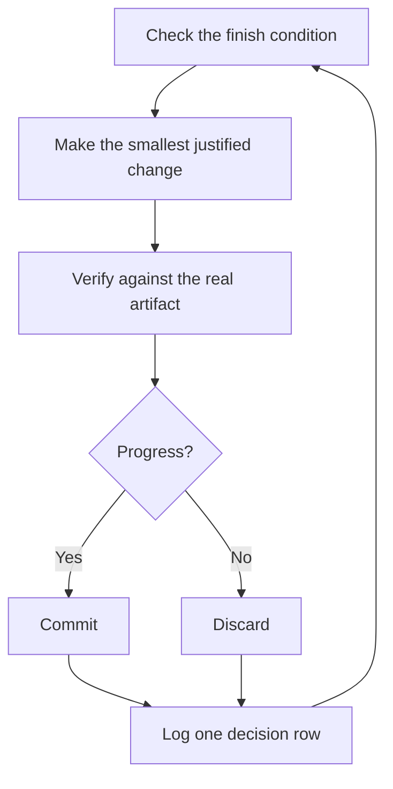
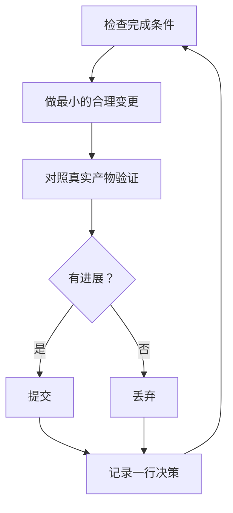

# Run work while you sleep

<!-- zh-CN:begin b407020bdf480bff -->

# 在你睡觉时运行工作

<!-- zh-CN:end b407020bdf480bff -->

This is the payoff for everything before it. An agent you can trust to verify its own work is an agent you can leave alone with a hard task. What makes that safe isn't hope. It's a checkable finish condition, an isolated worktree or cloud agent, and a decision log you audit in the morning.

<!-- zh-CN:begin 83991520e5a71238 -->

这是前面一切工作的回报。能信任其自行验证工作，就能把困难任务留给它独自处理。安全来自可检查完成条件、隔离工作树或云智能体，以及早晨审计的决策日志。

<!-- zh-CN:end 83991520e5a71238 -->


<!-- zh-CN:begin 09b8a30cc03a86b1 -->


<!-- zh-CN:end 09b8a30cc03a86b1 -->

## Earn the trust before the loop

<!-- zh-CN:begin 8040a16ede7bd69b -->

## 在循环前赢得信任

<!-- zh-CN:end 8040a16ede7bd69b -->

A loop you don't trust just produces unchecked work faster, and the mess compounds with every iteration. Before you leave one running, check that it has earned it:

<!-- zh-CN:begin bdf213fe76176632 -->

不信任的循环只会更快产生未检查工作，混乱随每轮累积。离开前确认它已赢得信任：

<!-- zh-CN:end bdf213fe76176632 -->

- You've done the task once by hand, or watched an agent do it, so you know what good looks like.

<!-- zh-CN:begin c78ecec0c4767e24 -->

- 你亲手完成过一次任务，或看过智能体完成，因此知道好结果是什么。

<!-- zh-CN:end c78ecec0c4767e24 -->
- The agent has the tools and signals you'd use yourself: the verification skill, the profiler, the logs.

<!-- zh-CN:begin 26790191d7172045 -->

- 智能体拥有你自己会用的工具和信号：验证技能、分析器、日志。

<!-- zh-CN:end 26790191d7172045 -->
- Every stage proves its work and can stop the line when the work misses the bar.

<!-- zh-CN:begin ebc2486cb159eb66 -->

- 每个阶段证明其工作，结果不达标时能停线。

<!-- zh-CN:end ebc2486cb159eb66 -->
- You've read a few transcripts and turned the repeated failures into tools, skills, or checks.

<!-- zh-CN:begin 29436af2f45e63cc -->

- 你读过一些记录，并把重复失败转化为工具、技能或检查。

<!-- zh-CN:end 29436af2f45e63cc -->

Make the loop autonomous only after all four hold. Until then, run it while you watch.

<!-- zh-CN:begin b2bbe79b287a6d1f -->

四项全部成立后才让循环自主。在此之前，运行时要盯着。

<!-- zh-CN:end b2bbe79b287a6d1f -->

## The overnight contract

<!-- zh-CN:begin 2b6f9a9023d10834 -->

## 夜间约定

<!-- zh-CN:end 2b6f9a9023d10834 -->

A good handoff has the goal, the finish condition, permissions, and an escape hatch. It doesn't need to be long:

<!-- zh-CN:begin fb1f4f615e02f438 -->

好的交接包含目标、完成条件、权限和逃生口。无需冗长：

<!-- zh-CN:end fb1f4f615e02f438 -->

```text
/poteto-mode im going to bed. migrate every caller to the new parser in a fresh worktree off <base>.
done means zero old callers, all parser fixtures pass, old api deleted.
keep a decision log. don't ask me before committing.
/loop until done. if you're truly stuck after a few hours, stop and write up why.
```

<!-- zh-CN:begin 1d78a88314577879 -->

```text
/poteto-mode 我要去睡了。从 <base> 新建工作树，把所有调用方迁移到新解析器。
完成意味着没有旧调用方，所有解析器夹具通过，旧 api 已删除。
保留决策日志。提交前不要问我。
/loop 直到完成。如果数小时后确实卡住，就停下并写明原因。
```

<!-- zh-CN:end 1d78a88314577879 -->

Walk through what each line buys you:

<!-- zh-CN:begin 08b89e67df2d4e6c -->

逐行说明价值：

<!-- zh-CN:end 08b89e67df2d4e6c -->

- "im going to bed" is a session override. The agent stops asking and keeps going.

<!-- zh-CN:begin 4b04a3ec84e7667e -->

- “我要去睡了”是会话覆盖。智能体停止提问并继续。

<!-- zh-CN:end 4b04a3ec84e7667e -->
- "done means..." turns the goal into checks every iteration can run.

<!-- zh-CN:begin 23bfa3ffbc965549 -->

- “完成意味着……”把目标变成每轮可运行检查。

<!-- zh-CN:end 23bfa3ffbc965549 -->
- "fresh worktree off `<base>`" keeps the run from colliding with anything else you have open.

<!-- zh-CN:begin 0fbd9bc6b99ed94f -->

- “从 `<base>` 新建工作树”避免与已打开工作冲突。

<!-- zh-CN:end 0fbd9bc6b99ed94f -->
- "don't ask me before committing" pre-answers the permission the agent would otherwise block on.

<!-- zh-CN:begin d81f52e71aaa199f -->

- “提交前不要问我”预先回答否则会阻塞的权限。

<!-- zh-CN:end d81f52e71aaa199f -->
- `/loop` is Cursor's built-in wake mechanism, not a pstack skill. The [Autonomous run playbook](../../skills/poteto-mode/playbooks/autonomous-run.md) uses it to re-check the finish condition on events or a heartbeat.

<!-- zh-CN:begin 57f20952acbad6dd -->

- `/loop` 是 Cursor 内建唤醒机制，不是 pstack 技能。[自主运行手册](../../skills/poteto-mode/playbooks/autonomous-run.md) 用它按事件或心跳复查完成条件。

<!-- zh-CN:end 57f20952acbad6dd -->
- The escape hatch lets it stop at a genuine dead end and write up why, which beats eight hours of creative goal reinterpretation.

<!-- zh-CN:begin d634eb6396c8fb71 -->

- 逃生口让它在真正死路处停下并写明原因，胜过八小时创造性曲解目标。

<!-- zh-CN:end d634eb6396c8fb71 -->

Because you'll review this work after stepping away, `/poteto-mode` routes it through [`/figure-it-out`](../../skills/figure-it-out/SKILL.md), which designs the run's phases before any code and wires in the decision log.

<!-- zh-CN:begin fff905487cca9c35 -->

因为之后会离开，`/poteto-mode` 通过 [`/figure-it-out`](../../skills/figure-it-out/SKILL.md) 路由，在任何代码前设计运行阶段并接入决策日志。

<!-- zh-CN:end fff905487cca9c35 -->

To stop a run on purpose, tell the agent to pause, or that you're about to go offline or restart Cursor. The [Pause safely playbook](../../skills/poteto-mode/playbooks/pause-safely.md) finishes or backs out of the current step, commits a work-in-progress checkpoint, and writes a resume note. A fresh chat picks the work up from that note through the Session pickup playbook. Saying "keep going" never triggers a pause.

<!-- zh-CN:begin edcdf8954f896a2f -->

要有意停止运行，告诉智能体暂停，或说明即将离线／重启 Cursor。[安全暂停手册](../../skills/poteto-mode/playbooks/pause-safely.md) 完成或回退当前步骤，提交进行中检查点并写恢复说明。新聊天通过会话接续手册从说明恢复。“继续”绝不触发暂停。

<!-- zh-CN:end edcdf8954f896a2f -->

## What the loop does all night

<!-- zh-CN:begin 736507a5221e364e -->

## 循环整夜做什么

<!-- zh-CN:end 736507a5221e364e -->



<!-- zh-CN:begin 5599efcf51f02de8 -->



<!-- zh-CN:end 5599efcf51f02de8 -->

One change, one check, one log row, every iteration. Changes that didn't help get discarded, not left to ride. A plateau means pivot, not stop, and the finish condition never quietly relaxes to declare victory.

<!-- zh-CN:begin 99013560805ba1c7 -->

每轮一次变更、一次检查、一行日志。没有帮助的变更丢弃，不留着凑数。平台期意味着转向而非停止，完成条件绝不悄悄放宽以宣布胜利。

<!-- zh-CN:end 99013560805ba1c7 -->

## The morning audit

<!-- zh-CN:begin 78914f75e4a9df0f -->

## 早晨审计

<!-- zh-CN:end 78914f75e4a9df0f -->

[`/show-me-your-work`](../../skills/show-me-your-work/SKILL.md) is what makes the run reviewable. Each row records the time, phase, decision, reason, an evidence pointer, and the result, in a TSV at `decisions.tsv` (or `.audit/<task-slug>.tsv` when several runs share a directory). It stays local by default. Commit it when the work is ambitious enough that a reviewer needs the trail to trust the result.

<!-- zh-CN:begin 8c64e4a618e8ed54 -->

[`/show-me-your-work`](../../skills/show-me-your-work/SKILL.md) 让运行可审查。每行在 `decisions.tsv`（多次运行共享目录时用 `.audit/<task-slug>.tsv`）记录时间、阶段、决策、理由、证据指针和结果。默认保持本地；工作足够宏大、审阅者需要轨迹才能信任结果时提交。

<!-- zh-CN:end 8c64e4a618e8ed54 -->

When you're back, ask for the run in review form:

<!-- zh-CN:begin 798cae847c3d7f67 -->

回来时，以审查形式询问运行：

<!-- zh-CN:end 798cae847c3d7f67 -->

```text
/show-me-your-work catch me up on what you did last night
```

<!-- zh-CN:begin 91459f4edfe325bd -->

```text
/show-me-your-work 讲讲你昨晚做了什么
```

<!-- zh-CN:end 91459f4edfe325bd -->

Before the skill hands back its summary, it spawns a reviewer on a different model family to read the trail and the transcript, and the reply ends with an Attention section listing what deserves your scrutiny. Read that section first, then the log rows it points at. You're auditing decisions, not re-reading the whole night.

<!-- zh-CN:begin 3b46725412634cd9 -->

技能返回摘要前，会启动另一模型家族的审查员阅读轨迹和记录；回复以 Attention 章节结尾，列出值得你审查的内容。先读该章节，再看其指向的日志行。你审计决策，不必重读整晚。

<!-- zh-CN:end 3b46725412634cd9 -->

For a quick status instead of an audit, run [`/ketchup`](../../skills/ketchup/SKILL.md) in the chat that ran the work. It reads only, and tells you in plain words what changed since your last message, with the screenshots and small diagrams the work produced. Then it lists each call waiting on you, such as a merge, an approval, or a choice between options, with its pick, the evidence, and the risk, so you can decide from the reply alone.

<!-- zh-CN:begin 6beed2e01af80f6f -->

只要快速状态而非审计，在运行工作的聊天中执行 [`/ketchup`](../../skills/ketchup/SKILL.md)。它只读，用朴素语言说明自上次消息以来的变化，并附工作产生的截图和小图。随后列出等待你处理的每个决定，例如合并、批准或选项，附选择、证据和风险，让你仅凭回复决定。

<!-- zh-CN:end 6beed2e01af80f6f -->

## When the night holds a queue, not a task

<!-- zh-CN:begin 4a40ccc9b5af4713 -->

## 夜晚拥有队列而非单项任务

<!-- zh-CN:end 4a40ccc9b5af4713 -->

The contract above drives one task to one finish condition. Some nights hold more, a queue of independent changes or a whole program. Three playbooks scale the same trust up.

<!-- zh-CN:begin 2b2f2c9b099cd196 -->

上述约定把一个任务推向完成条件。有些夜晚包含更多：独立变更队列或整个项目。三个手册按同一信任模型扩展。

<!-- zh-CN:end 2b2f2c9b099cd196 -->

[Autopilot-full](../../skills/poteto-mode/playbooks/autopilot-full.md) runs a queue of independent PRs to merged. Each PR gets one owner agent that carries it from build through merge, and no owner merges on its own verdict. A swarm of fresh verifiers checks the owner's code-ready head. A later rebase or minor fix gets one fresh verifier, and only new behavior or a large new diff calls the full swarm again. Only a clean verdict on the patch that merges authorizes the merge:

<!-- zh-CN:begin f64805c6a6daddd8 -->

[Autopilot-full](../../skills/poteto-mode/playbooks/autopilot-full.md) 将独立 PR 队列运行到合并。每个 PR 一个负责人智能体，从构建带到合并；负责人不得凭自己的结论合并。全新验证者集群检查代码就绪头版本。后续变基或小修复用一个新验证者；只有新行为或大差异才再次完整集群。只有对即将合并补丁给出的干净结论才授权合并：

<!-- zh-CN:end f64805c6a6daddd8 -->

```text
/poteto-mode full autopilot on this queue. each item is independent. i want them merged by morning.
```

<!-- zh-CN:begin 50f5d16e73edf2e6 -->

```text
/poteto-mode 对这个队列启用完整自动驾驶。每项独立。我希望早上都已合并。
```

<!-- zh-CN:end 50f5d16e73edf2e6 -->

[Autopilot-stack](../../skills/poteto-mode/playbooks/autopilot-stack.md) is Autopilot-full without the merge. You wake up to verified PRs, each with its verdict, and you review and land them yourself. A PR stacks only on a PR it builds on. Pick it over Autopilot-full when you want your own eyes on the work before anything merges:

<!-- zh-CN:begin e8538354288a4767 -->

[Autopilot-stack](../../skills/poteto-mode/playbooks/autopilot-stack.md) 是不合并的 Autopilot-full。你醒来得到已验证 PR 及结论，自行审阅和落地。PR 只堆叠在它依赖的 PR 上。希望在合并前亲自检查时使用：

<!-- zh-CN:end e8538354288a4767 -->

```text
/poteto-mode autopilot these five changes, but don't merge. i'll land them in the morning.
```

<!-- zh-CN:begin b7469edc3503fccd -->

```text
/poteto-mode 自动运行这五个变更，但不要合并。我早上自己落地。
```

<!-- zh-CN:end b7469edc3503fccd -->

[Orchestrate](../../skills/poteto-mode/playbooks/orchestrate.md) is for a program that outlives any single agent: multi-day, many stacked PRs, fleets of subagents under one standing coordinator chat. The coordinator decides which agent does each piece of work, checks what each one produces, and never writes code itself. If one agent could finish the work in a session, the playbook itself routes you back to the overnight contract above:

<!-- zh-CN:begin adfe2847c94628f1 -->

[Orchestrate](../../skills/poteto-mode/playbooks/orchestrate.md) 用于超过单个智能体的项目：多天、多个堆叠 PR、一个长期协调聊天下的大量子智能体。协调器决定每个工作者做哪部分、检查产出，绝不自己写代码。一个智能体一个会话可完成时，手册会让回上述夜间约定：

<!-- zh-CN:end adfe2847c94628f1 -->

```text
/poteto-mode orchestrate the store migration. own it until every package is converted and merged. i'll check in twice a day.
```

<!-- zh-CN:begin b66dae1f427bfdd0 -->

```text
/poteto-mode 编排商店迁移。负责到每个包都转换并合并。我每天检查两次。
```

<!-- zh-CN:end b66dae1f427bfdd0 -->

## Run many projects in parallel

<!-- zh-CN:begin 4f07ed54a25caa41 -->

## 并行运行多个项目

<!-- zh-CN:end 4f07ed54a25caa41 -->

A [Cursor Project](https://cursor.com/blog/projects) gives one coordinator agent a persistent thread. The coordinator doesn't write code. It directs subagents, which run in the cloud by default, so the work continues when your laptop is closed. That's the shape the Orchestrate playbook expects. Start your prompts to the coordinator with `/poteto-mode`, and the subagents it spawns follow the playbooks.

<!-- zh-CN:begin f57018267ba4ad8d -->

[Cursor Project](https://cursor.com/blog/projects) 给协调智能体一个持久线程。协调器不写代码，指挥默认在云端运行的子智能体，因此笔记本关闭后工作继续。Orchestrate 手册预期此形态。向协调器输入以 `/poteto-mode` 开头的提示，它启动的子智能体遵循手册。

<!-- zh-CN:end f57018267ba4ad8d -->

A few habits help:

<!-- zh-CN:begin f8b8b443466ece16 -->

几个习惯有帮助：

<!-- zh-CN:end f8b8b443466ece16 -->

- Give each body of work its own Project, such as a feature, a migration, a perf push, or a tech-debt cleanup. Several can run side by side.

<!-- zh-CN:begin 4c6b98c34dea7498 -->

- 每项工作独立 Project，例如功能、迁移、性能推进或技术债清理。多个可并行。

<!-- zh-CN:end 4c6b98c34dea7498 -->
- Drag related chats into the Project, finished ones included. They become context for every agent in it.

<!-- zh-CN:begin fbadeacc6c00851c -->

- 把相关聊天拖入 Project，包括已结束聊天。它们成为其中每个智能体的上下文。

<!-- zh-CN:end fbadeacc6c00851c -->
- Give each PR a verification swarm before it merges, and let Autopilot-stack or Autopilot-full carry the queue.

<!-- zh-CN:begin 7c36dc615f75e526 -->

- 每个 PR 合并前设置验证集群，让 Autopilot-stack 或 Autopilot-full 承载队列。

<!-- zh-CN:end 7c36dc615f75e526 -->
- Ask the coordinator for a plan backed by data, and have it answer open questions with prototypes before it asks you.

<!-- zh-CN:begin ac5bed35ad45fec1 -->

- 向协调器索取有数据支持的证据，让它在询问前用原型回答开放问题。

<!-- zh-CN:end ac5bed35ad45fec1 -->

One prompt can carry a whole Project, from research through execution:

<!-- zh-CN:begin c6062454dabf18e0 -->

一条提示可承载整个 Project，从研究到执行：

<!-- zh-CN:end c6062454dabf18e0 -->

```text
/poteto-mode refactor this repo so its architecture is more agent friendly. use /correct and /architect on past commits and review comments to find the mistakes agents make most here. use /recall for context from past chats. answer open questions with prototypes instead of asking me. come back with a plan backed by real data. once i approve it, run it with autopilot-stack or autopilot-full, and ask me which.
```

<!-- zh-CN:begin 13843d8207a7c565 -->

```text
/poteto-mode 重构此仓库，使架构更适合智能体。对过去提交和审查评论使用 /correct 与 /architect，找出智能体最常犯的错误。用 /recall 获取过去聊天上下文。用原型回答开放问题，不要问我。带一个由真实数据支持的证据回来。我批准后，用 autopilot-stack 或 autopilot-full 运行，并问我选哪个。
```

<!-- zh-CN:end 13843d8207a7c565 -->

## Let loops start themselves

<!-- zh-CN:begin d750e282b9b5ae90 -->

## 让循环自行启动

<!-- zh-CN:end d750e282b9b5ae90 -->

Every loop above still waits for you to start it. A scheduled or event-driven automation removes that step. Software maintenance splits into stages that suit this well: triage a report, reproduce it, fix it, verify the fix. Two rules keep such a line trustworthy:

<!-- zh-CN:begin 7c4bcde8989da09b -->

上述循环仍等待你启动。定时或事件驱动自动化移除该步骤。软件维护可分成适合自动化的阶段：分诊报告、复现、修复、验证。两条规则保证流水线可信：

<!-- zh-CN:end 7c4bcde8989da09b -->

- Every stage can stop the line. Triage can decide the report is expected behavior, repro can fail to reproduce it, and the fixer can judge the change too risky. Each of those outcomes is useful, because it keeps bad work from reaching the next stage, where it costs more to undo.

<!-- zh-CN:begin 7058d371927b8adf -->

- 每个阶段能停线。分诊可判为预期行为，复现可失败，修复者可判风险过高。这些结果都有用，阻止坏工作进入下一阶段，因为后面撤销成本更高。

<!-- zh-CN:end 7058d371927b8adf -->
- Every stage hands over evidence. Repro attaches screenshots and video of the broken state, and the fix attaches before-and-after proof. A human can then check that the agent fixed the right thing before reading a line of code.

<!-- zh-CN:begin a39d0217b7f16c93 -->

- 每个阶段交证据。复现附坏状态截图和视频，修复附前后证明。人能在读一行代码前检查修的是不是对的问题。

<!-- zh-CN:end a39d0217b7f16c93 -->

pstack ships this as a dormant [automation pack](../../automations/benny/README.md) for Slack issue reports. One automation triages each report. The other reproduces confirmed bugs and may prepare a small draft fix. Point an agent at its [`FOR_AGENTS.md`](../../automations/benny/FOR_AGENTS.md) and name the target repository to set it up.

<!-- zh-CN:begin 96a917a2dc1e5470 -->

pstack 提供一个面向 Slack issue 报告的休眠[自动化包](../../automations/benny/README.md)。一个自动化分诊报告，另一个复现确认 bug 并准备小型草稿修复。让智能体读取 [`FOR_AGENTS.md`](../../automations/benny/FOR_AGENTS.md) 并指定目标仓库即可设置。

<!-- zh-CN:end 96a917a2dc1e5470 -->

**Pitfall:** a duration is not a finish condition. "work on this for 4 hours" gives the agent nothing to check, and you'll wake up to four hours of motion instead of a result. Give `/loop` a predicate that can pass or fail.

<!-- zh-CN:begin 7e81f7546744e869 -->

**陷阱：**时长不是完成条件。“做四小时”没有可检查内容，醒来只有四小时动作而没有结果。给 `/loop` 能通过或失败的谓词。

<!-- zh-CN:end 7e81f7546744e869 -->

Next: [Steer with principle names](./08-principles.md).

<!-- zh-CN:begin 3e36a765eef161c2 -->

下一步：[用原则名称转向](./08-principles.md)。

<!-- zh-CN:end 3e36a765eef161c2 -->
