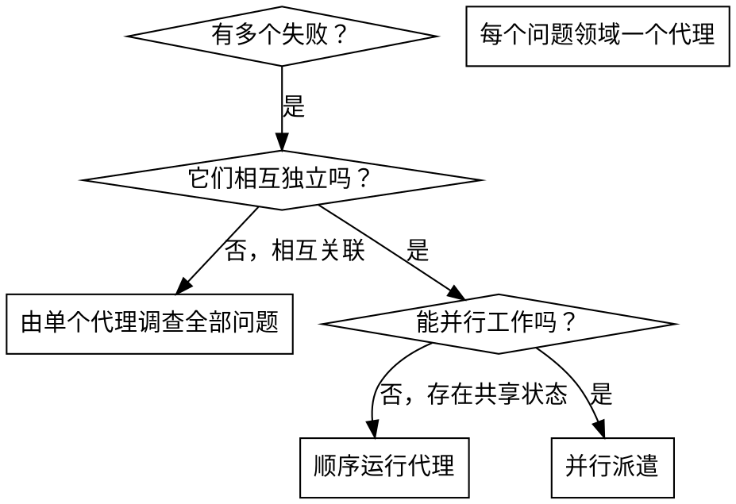

# 派遣并行代理

## 概述

你将任务委派给具有隔离上下文的专门代理。通过精确编写指令并提供上下文，确保他们专注于任务并成功完成。他们绝不应继承你会话中的上下文或历史——你应准确构造他们所需的内容。这也能保留你自己的上下文，用于协调工作。

当存在多个互不相关的失败（不同测试文件、不同子系统、不同缺陷）时，顺序调查会浪费时间。每项调查都是独立的，可以并行开展。

**核心原则：** 为每个独立问题领域派遣一个代理，让他们并发工作。

## 何时使用



**适用情形：**

- 3 个及以上测试文件失败，且根本原因不同。

- 多个子系统各自独立地出问题。

- 无需其他问题的上下文就能理解每个问题。

- 各项调查之间没有共享状态。

**不适用情形：**

- 失败相互关联（修复一个可能同时修好其他问题）。

- 需要理解完整系统状态。

- 代理之间会相互干扰。

## 工作模式

### 1. 识别独立领域

按故障内容分组：

- 文件 A 的测试：工具审批流程。

- 文件 B 的测试：批量完成行为。

- 文件 C 的测试：中止功能。

每个领域都是独立的——修复工具审批不会影响中止测试。

### 2. 创建范围集中的代理任务

每个代理获得：

- **具体范围：** 一个测试文件或子系统。

- **明确目标：** 让这些测试通过。

- **约束：** 不要修改其他代码。

- **预期输出：** 总结发现与修复内容。

### 3. 并行派遣

在同一条回复中发出全部三个子代理派遣——它们会并行运行：

```text
Subagent (general-purpose): "修复 agent-tool-abort.test.ts 的失败"
Subagent (general-purpose): "修复 batch-completion-behavior.test.ts 的失败"
Subagent (general-purpose): "修复 tool-approval-race-conditions.test.ts 的失败"
# 三者并发运行。
```

同一条回复中进行多次派遣调用 = 并行执行。每条回复只派遣一个 = 顺序执行。

### 4. 审查与集成

代理返回后：

- 阅读每份总结。

- 验证修复之间没有冲突。

- 运行完整测试套件。

- 集成全部改动。

## 代理提示结构

好的代理提示具有以下特点：

1. **专注**——一个清楚的问题领域。

2. **自包含**——包含理解问题所需的全部上下文。

3. **明确规定输出**——代理应该返回什么？

```markdown
修复 src/agents/agent-tool-abort.test.ts 中失败的 3 个测试：

1. "应在捕获部分输出时中止工具"——预期消息中包含 'interrupted at'
2. "应处理已完成与已中止工具的混合情况"——快速工具被中止，而不是完成
3. "应正确跟踪 pendingToolCount"——预期 3 个结果，实际得到 0 个

这些是时序/竞态条件问题。你的任务：

1. 阅读测试文件，理解每项测试验证什么
2. 找出根本原因——是时序问题，还是实际缺陷？
3. 通过以下方式修复：
   - 用基于事件的等待替代任意设置的超时时间
   - 如果发现中止实现中的缺陷，予以修复
   - 如果测试覆盖的行为已经改变，调整测试预期

不要只是增加超时时间——找到真正的问题。

返回：总结发现了什么，以及修复了什么。
```

## 常见错误

**❌ 范围过大：** “修复所有测试”——代理会迷失方向。
**✅ 具体：** “修复 agent-tool-abort.test.ts”——范围集中。

**❌ 没有上下文：** “修复竞态条件”——代理不知道在哪里。
**✅ 提供上下文：** 粘贴错误消息和测试名称。

**❌ 没有约束：** 代理可能重构所有内容。
**✅ 给出约束：** “不要修改生产代码”或“只修复测试”。

**❌ 输出含糊：** “修好它”——你不知道改了什么。
**✅ 具体：** “返回根本原因与改动的总结”。

## 何时不应使用

**相关的失败：** 修复一个可能同时修好其他问题——先放在一起调查。
**需要完整上下文：** 必须查看整个系统才能理解。
**探索性调试：** 你还不知道哪里出了问题。
**共享状态：** 代理会相互干扰（编辑相同文件、使用相同资源）。

## 来自实际会话的示例

**场景：** 一次重大重构后，3 个文件中有 6 项测试失败。

**失败：**

- agent-tool-abort.test.ts：3 项失败（时序问题）。

- batch-completion-behavior.test.ts：2 项失败（工具没有执行）。

- tool-approval-race-conditions.test.ts：1 项失败（执行次数 = 0）。

**决定：** 属于独立领域——中止逻辑、批量完成、竞态条件彼此分开。

**派遣：**

```
Agent 1 → 修复 agent-tool-abort.test.ts
Agent 2 → 修复 batch-completion-behavior.test.ts
Agent 3 → 修复 tool-approval-race-conditions.test.ts
```

**结果：**

- Agent 1：用基于事件的等待替换超时。

- Agent 2：修复事件结构缺陷（threadId 位置错误）。

- Agent 3：添加等待，直到异步工具执行完成。

**集成：** 全部修复彼此独立，没有冲突，完整测试套件全部通过。

## 验证

代理返回后：

1. **审阅每份总结**——理解改了什么。

2. **检查冲突**——代理是否编辑了相同代码？

3. **运行完整套件**——验证所有修复协同工作。

4. **抽查**——代理可能犯系统性错误。
