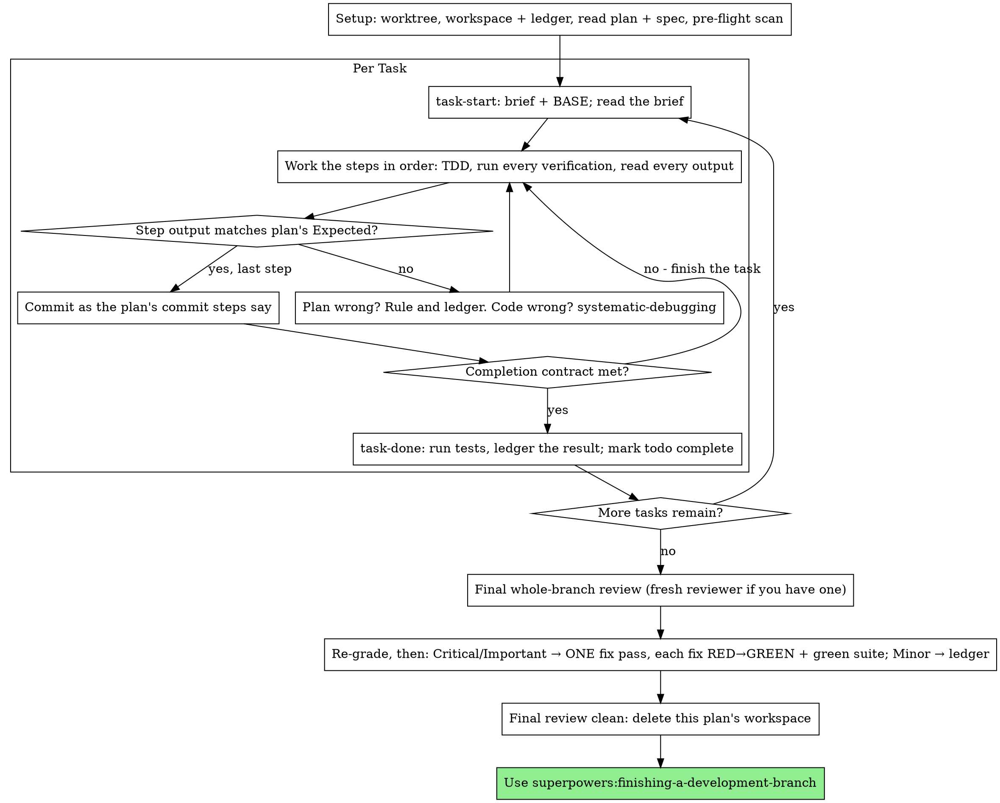

# 执行计划

在本会话中亲自逐项执行计划：不为每个任务安排实现子代理，也不为每个任务安排审查者。在最后，以全新上下文对整个分支进行一次审查。

**为什么在当前会话直接执行：** 子代理驱动开发会为每个任务付出一个全新实现者和一个全新审查者的成本，两者都要从头重新阅读代码库。在当前会话直接执行只需一个上下文（你的上下文），再加上最后的一位审查者。它放弃的是每个任务的全新上下文，以及每个任务的第二双眼睛。本技能用其他方式保留这两项机制带来的价值：任务简报就是规格，台账就是记忆，TDD 是每个任务的关卡，最终审查者就是第二双眼睛。

**核心原则：** 计划已经完成思考。严格执行它，用亲眼看到先失败、后通过的测试证明每一步，并留下即使自己遗忘也能延续的记录。

**过程叙述：** 工具调用之间最多叙述简短的一行；记录由台账和工具结果承载。

**连续执行：** 不要在任务之间停下来征询人类搭档。他们选择在当前会话直接执行是为了减少开销，不是为了在每个任务后回答“我应该继续吗？”。不中断地执行计划中的所有任务。

**作出裁决，而不是停滞。** 遇到冲突、歧义、计划缺陷，要作出决定。规格具有约束力，计划是基于规格提出的论证；两者都未给出答案时，用你的判断解决。把每个决定按 `Ruling: <what you decided> — <why> — <what it costs if wrong>` 的格式记入台账，然后继续。这一格式表示“裁决：决定了什么 — 为什么 — 如果判断错误会付出什么代价”。偏离计划却不在台账中记录裁决，就是秘密作出的决定。

只有以下四种情况能让你停下：不可逆或破坏性操作；涉及安全的操作；按照惯例应事先征询、且会影响此 worktree 之外的副作用（如合并、推送到共享分支、发布）；以及计划已经破损到所有前进路径都只能靠猜。这些情况应停下来询问。

## 何时使用

- 你已有 superpowers:writing-plans 生成的计划，并且人类搭档在交接时选择在当前会话直接执行。

- 运行宿主没有子代理工具（参阅 `../using-superpowers/references/` 中各平台的参考文件）。绝不要虚构派发过程；直接在这里运行计划。

- 任务大体独立；这与 superpowers:subagent-driven-development 的前提相同。

规格完整的计划，会把直接执行变成转写加测试：中档会话模型也能胜任；最强模型唯一值得付出额外成本的地方是最终审查，本技能会单独派发这一审查。人类搭档选择直接执行时，要告诉他们这一点。

当人类搭档希望每个任务都有审查关卡，或计划足够长、以至于后面的任务将运行在被压缩过的上下文中时，优先使用 superpowers:subagent-driven-development。长计划也能直接执行——台账使其可以恢复——但最后的任务能够获得的你的有效上下文最少。

## 流程

%% 流程：准备；逐任务读简报并按 TDD 执行验证；失败时区分计划或代码问题；完成任务后审查全分支，修复严重问题并清理工作区。

## 准备

确保工作在隔离工作区中进行：使用 superpowers:using-git-worktrees 创建一个，或验证现有工作区。没有人类搭档明确同意，绝不要在 main/master 分支上开始实现。

对话记忆无法在上下文压缩后保留下来。直接执行者一旦丢失进度，就会重新实现那些已经存在提交的任务；这与控制者重复派发任务是同一种失败，只是成本消耗在你自己的上下文里。要用台账文件跟踪进度，而不能只用待办事项。宿主的待办事项是实时视图；台账才是记录。

工作区和台账与 superpowers:subagent-driven-development 共用，目录和格式都相同，因此计划可以中途更换执行者，新的执行者从同一份台账继续。

- 每个计划拥有自己的工作区：技能启动时，运行 `../subagent-driven-development/scripts/sdd-workspace PLAN_FILE`。它会打印该计划被 git 忽略的目录（`<repo-root>/.superpowers/sdd/<plan-basename>/`），其中存放本计划的全部产物：台账、简报、审查包。其他计划的目录绝不是供你读写的。

- 在 `<workspace>/progress.md` 检查本计划的台账。如果第一行写的是你的计划文件，那么带有 `Task <N>: complete` 行的任务已完成，不要重做；从第一个没有完成记录的任务继续。即使上下文已经不记得创建过提交，提交仍然存在于 git 中：上下文压缩后，相比自己的回忆，要相信台账和 `git log`。第一行写着其他计划文件的台账属于其他计划；不要动它，为自己的计划新建台账。

- 创建台账时，第一行写明身份：`# SDD ledger — plan: <plan file path>`。

- `git clean -fdx` 会销毁工作区，因为它是被 git 忽略的临时区域；如遇这种情况，从 `git log` 恢复。

阅读一次计划，记下其上下文和 Global Constraints（全局约束），为每个任务创建待办事项。如果计划指定了 Spec，也要阅读：规格是计划立论的权威依据，计划内部的冲突应依据规格解决。若计划没有可访问的规格，应在台账中注明；没有规格时作出的裁决都是暂定的。

**必需子技能：** 现在就加载 superpowers:test-driven-development，必须在任务 1 之前。它约束下面每个任务的每一步；即使计划步骤已经写明“先编写失败测试”，也不能免除阅读该技能的要求。

在任务 1 之前，扫描计划，查找任务之间的冲突。计划的 Interfaces 块会指明检查位置：对于每个会使用前面任务产出内容的任务，在台账中写一行，列出这两个任务、前者产出与后者消费的对照，以及发现的情况。没有共享内容的任务不需要写记录；若所有任务都没有共享内容，只写一行 `Pre-flight: no shared interfaces`。对于每行暴露出的冲突，以规格为约束依据作出裁决，在该行旁边记录，然后开始任务 1。每个任务自身的文字应在阅读其简报时检查，而不是在这里检查。

## 任务循环

你打印的所有内容，以及所有工具结果，都会在会话剩余时间里占据上下文。把长测试输出重定向到工作区中的文件，只读其末尾；阅读任务简报，不要阅读整份计划。

### 1. 领取任务

- 运行本技能的 `scripts/task-start PLAN_FILE N`。它会在一次调用中打印简报路径和 BASE（确定任务提交范围起点的提交）。每个任务都要阅读简报，包括你自认为还记得的准备阶段内容：你记得的是摘要，简报里才有精确的值、签名和测试用例。

- 将该任务的待办状态标为 in_progress。

每次工具调用都是一个会重新阅读全部上下文的轮次。记账应随工作一起完成：在提交的同一次调用中追加台账，绝不要为记账单独调用一次。

### 2. 执行步骤

计划步骤已经按 RED-GREEN 排好顺序；在准备阶段加载的 superpowers:test-driven-development 约束下，按该顺序执行。测试步骤的代码要先写、先运行。亲眼看到它失败是一个步骤，不是形式要求；若实现尚不存在而测试已通过，这本身就是关于测试的发现。

每个运行命令的步骤都有一行 `Expected:`。执行命令，阅读输出并进行比较。有三种结果：

- **相符。** 进入下一步。

- **代码有误。** 使用 superpowers:systematic-debugging。找到原因；绝不要只为让步骤输出相符而修补表面症状。

- **计划有误：** 某一步与规格矛盾，前面任务的接口与本任务使用的接口不匹配，或者某个命令根本无法运行。就满足规格的最小改动作出裁决，按 `Task <N>: Ruling: <finding> — <what you decided and why>` 记入台账，然后继续。这一记录应写明发现、决定及其原因。裁决靠记录传递，不靠记忆：后续任务碰到相同接口时，从台账读取它。

按计划中的提交步骤提交。一个任务跨越多个提交也没问题；审查范围必须从 BASE 截取，绝不能用 `HEAD~1`。

### 3. 完成契约

在写入任务台账行之前，下列各项都必须已经成立，并且本会话中有证据，而不能仅凭差异看起来正确就推断：

- 简报列出的每个测试都已存在、都在本任务中运行过，且你已阅读输出。

- 任务最后一次测试运行通过；`task-done` 就是这次运行，它会把命令和结果写入台账行。

- 简报中的每一行 `Expected:` 都已与实际输出比较。

- 每一处偏离简报的情况，都有台账中的 `Ruling:` 行。

**必需子技能：** 完成声明受 superpowers:verification-before-completion 约束。只要缺少任何一项，任务就未完成，应继续完成它。

### 4. 完成任务

使用简报为整个任务指定的测试命令，运行本技能的 `scripts/task-done PLAN_FILE N BASE -- <test command>`。它会执行测试，把完整输出保存在工作区中，打印末尾内容，并且仅在测试通过时向台账追加完成行：

`Task <N>: complete (commits <base7>..<head7>, tests: <command> → <result>)` 中文说明：记录任务编号、提交范围、测试命令和结果。

该行记录任务完成状态、提交范围、测试命令及结果。运行失败不会记录任何内容；任务仍未完成。记录成功后，把待办标为完成，领取下一个任务。

## 最终审查

运行 `../subagent-driven-development/scripts/review-package PLAN_FILE MERGE_BASE HEAD`，然后根据它打印出的文件开展审查。MERGE_BASE 是分支开始时的提交，例如 `git merge-base main HEAD`。

**有子代理工具时：** 使用可用模型中能力最强的模型派发审查者，因为整个分支的审查是一项判断任务。采用 superpowers:requesting-code-review 的 [code-reviewer.md](../requesting-code-review/code-reviewer.md)，提供审查包路径、计划和规格路径；如果计划有 Review Focus 一节，就逐字提供其内容（它列出计划测试没有覆盖的输入类别与失败模式，审查者应逐项有意识地检查），还要指向台账中的 `Ruling:` 行，以便其权衡你作出的判断。明确指定模型；省略模型会继承会话模型，而它未必最强。这是整个执行过程中唯一获得的全新上下文。不要跳过，也不要用自己阅读差异代替。

**没有子代理工具时：** 阅读 code-reviewer.md，在最后一个任务的台账行之后，另起一轮，自己针对审查包执行该审查。将 `Final review: self-review (no subagent tool)` 写入台账，并在最终消息中说明这一点：作者自审弱于全新审查者，人类搭档需要在合并前判断这是否足够。

采取任何行动之前先对发现进行分类。审查者给出的严重程度标签只是建议；关卡由你负责。其“Declined to judge”（未作判断）清单也归你处理：每一行都需要像计划冲突一样作出并记录裁决，格式为 `Final: Ruling: <behavior the reviewer set aside> — <what a reasonable person using this software gets, and why that stands or why it is now a finding> — <cost if wrong>`。也就是记录审查者搁置的行为、合理使用者实际会遇到什么、为何维持现状或为何应列为问题，以及判断错误的代价。先按实际影响重新分级：规格是一份愿景文档，问题的级别取决于发布后合理使用者会遭遇什么，而非规格是否点名触发它的输入。因为规格未提及就把问题定为 Minor 的审查者，评的是规格，不是影响。然后：

- **Critical 和 Important** 进入修复轮次。

- **Minor** 按 `Final: minor (deferred): <one-liner>` 记入台账，并在最终消息的“Deferred minors”（延期处理的轻微问题）中列出。Minor 绝不进入修复轮次，也绝不变成裁决；裁决是对冲突作出的决定，不是你拒绝一个润色建议的备注。

你就是这里的实现者，应亲自在一轮中修复 Critical 和 Important 问题。每项修复由 TDD 验证，不由第二位审查者验证：编写能复现问题的测试，亲眼看到失败，使之通过，再运行整个测试套件。每项都按 `Final: fixed <finding> — <test name> RED→GREEN, suite <N>/<N>` 记入台账。没有先失败测试的修复不算经过验证；修复轮次后测试套件未全绿，表示这一轮尚未结束。不要派发复审：它只会重读一份差异，而覆盖测试已经回答“已处理”，测试套件的运行已经回答“没有破坏其他内容”。

你决定不修复的问题属于裁决，应按 `Final: Ruling: <finding> — <why the code stands> — <cost if wrong>` 记录，并通过裁决清单传达给人类搭档。不会有第二轮修复。

## 收尾

删除任何内容之前，收集台账中包含 `Ruling:` 的每一行，按作出顺序放入最终消息的“Rulings I made”（我作出的裁决）中，每项均附判断错误的代价；把每一行 `minor (deferred)` 放入“Deferred minors”（延期处理的轻微问题）中。两份清单都必须穷尽全部条目。你代人类搭档作出的决定，以及选择不采取行动的问题，只有在最终消息中才会传达给他们。

最终审查通过、修复也已提交后，删除本计划的工作区目录；现在 git 历史就是记录。相邻目录属于其他计划，不要动它们。

使用 superpowers:finishing-a-development-branch。

## 常见的自我辩解

| 借口 | 实际情况 |
|--------|---------|
| “我记得任务 N 说了什么” | 你记得的是摘要。简报里有精确的值。阅读它。 |
| “计划里的代码是对的，不用看测试失败” | 从未亲眼看见失败的测试证明不了任何事。这是一个步骤。运行它。 |
| “我会最后跑完整套件，不必每一步都跑” | 每步运行才能知道是哪一步弄坏了它。任务结束时的运行是完成契约，不能替代逐步运行。 |
| “计划这里错了，我直接做正确的事” | 做正确的事，并在台账中记录裁决。未记录的偏离是秘密作出的决定。 |
| “做完几个任务再补台账” | 上下文压缩不会等方便的时候才发生。每个任务一行，与提交放在同一条消息中。 |
| “下一个任务前先问问搭档” | 他们选择直接执行是为了减少开销。进度询问会消耗他们的时间。只有那四种停止条件能让你停下。 |
| “我已经仔细读过自己的差异，最终审查者是多余的” | 同一位作者有同样的盲点。审查者是本轮唯一的全新上下文。 |
| “测试应该会通过，改动太小了” | “应该”不是证据。契约要求有命令及其输出。 |
| “子代理又慢又贵，最终审查也省了” | 直接执行已经去掉了每个任务的审查者。整个分支的一次审查是最低要求，不是最高要求。 |
| “审查者说是 Minor，那就是 Minor” | 那个标签评的是规格未作说明。要评定使用者会遭遇什么。先重新分级，再把关。 |
| “修复很明显，不需要先写失败测试” | 失败测试是证明问题确实存在且现已消失的唯一证据。没有它，你只有差异和希望。 |
| “顺手把 Minor 也修了” | 每修一个 Minor，都要增加搭档并未要求的测试、修复和套件运行。把它们记入台账，由搭档决定。 |
