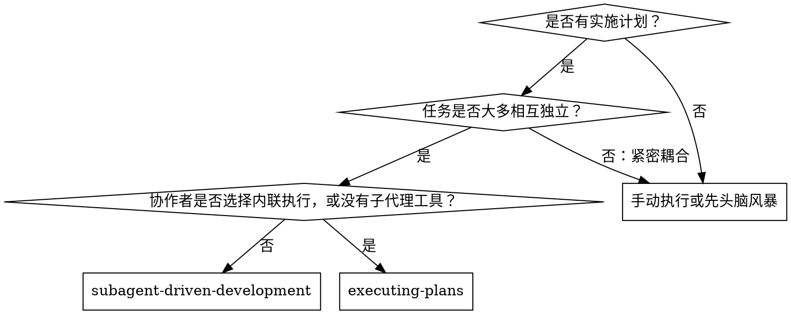
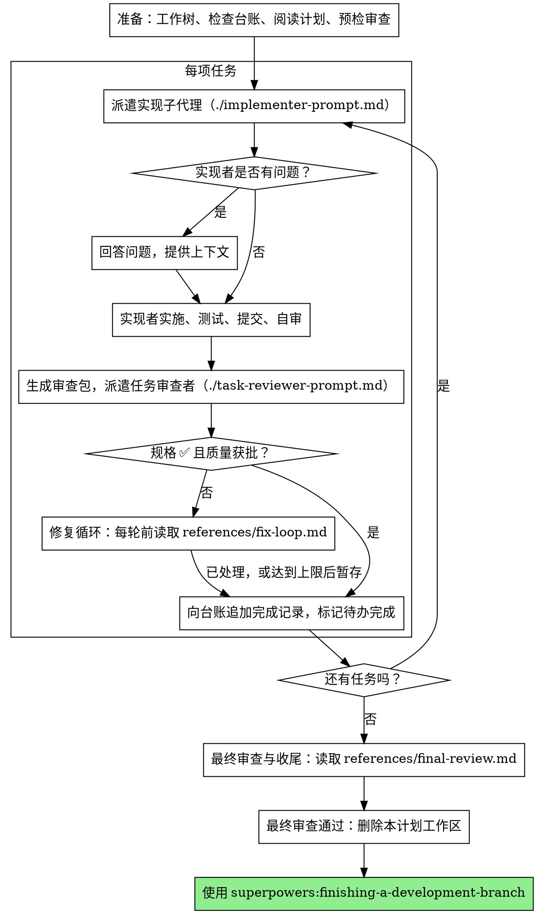

# 子代理驱动开发

通过为每项任务派遣一个全新的实现子代理来执行计划；每项任务结束后进行任务审查（规格符合性 + 代码质量），最后对整个分支进行一次全面审查。

**为什么使用子代理：** 你将任务委派给具有隔离上下文的专门代理。通过精确编写指令并提供上下文，确保他们专注于任务并成功完成。他们绝不应继承你会话中的上下文或历史——你应准确构造他们需要的内容。这也能保留你自己的上下文，用于协调工作。

**核心原则：** 每项任务使用全新子代理 + 任务审查（规格 + 质量）+ 全面最终审查 = 高质量、快速迭代。

**过程说明：** 两次工具调用之间，最多用一行简短文字说明——台账和工具结果承担记录职责。

**连续执行：** 不要在任务之间暂停，向人类协作者询问或汇报后等待回应。不间断地执行计划中的所有任务。只有下文列出的四种情况，或所有任务都已完成，才是停止的理由。“是否继续？”之类的提示和进度总结会浪费对方的时间——他们让你执行计划，就执行计划。

**作出裁定，不要停滞。** 正在执行的计划不等待人类。遇到冲突、歧义、计划缺陷，或原本想请求突破的上限——自行决定。规格是具有约束力的权威，计划是基于规格展开的论证，两者都没有解答的部分由你的判断决定。把每项决定记录在台账中，格式为 `Ruling: <what you decided> — <why> — <what it costs if wrong>`（裁定：你决定了什么——为什么——判断错误会付出什么代价），然后继续。错误裁定的代价，是人类协作者看得到、可以撤销的返工；让会话停在一个问题上，则会耗费对方一整天，却一无所获。

只有以下四种情况会让你停止：不可逆或具有破坏性的操作；涉及安全敏感事项的操作；发生在此工作树之外、按惯例应事先征询的副作用（合并、推送到共享分支、发布）；以及计划已经严重损坏，以至于所有前进路径都只能靠猜。在这些情况下，停下来询问。

## 何时使用

**与 Executing Plans（在当前上下文直接执行）相比：**

- 每项任务使用全新子代理（没有上下文污染），而不是由一个上下文完成所有任务。

- 每项任务结束后审查（规格符合性 + 代码质量），而不是只在最后审查。

- 每项任务和每次审查都需要一个全新上下文；直接执行只需一个上下文，加上一位最终审查者。

- 两种方式都在当前会话中运行，共享相同的计划工作区和台账，任务之间从不暂停。

## 流程

## 准备

确保工作在隔离工作区中进行：使用 `superpowers:using-git-worktrees` 创建工作区，或验证现有工作区。未经人类协作者明确同意，绝不要在 main/master 分支上开始实施。

对话记忆无法在上下文压缩后完整保留。在实际会话中，丢失进度的控制者曾重新派遣整串已完成的任务——这是观察到的代价最高的单一失误。应在台账文件中跟踪进度，而不只是依靠待办事项。

- 每份计划拥有自己的工作区：技能开始时，运行此技能的 `bash scripts/sdd-workspace PLAN_FILE`——它会输出此计划被 git 忽略的目录（位于 `<repo-root>/.superpowers/sdd/` 下），本计划的所有产物都存放在这里：台账、任务简报、报告、审查包。其他计划的目录绝不属于你的读写范围。

- 检查 `<workspace>/progress.md` 是否有此计划的台账。如果存在，先于其他任何操作读取 [references/resuming.md](references/resuming.md)：其中说明台账属于谁，以及应从哪里恢复。

- 创建台账，并把标识写为第一行：`# SDD ledger — plan: <plan file path>`。

- 台账是恢复进度的地图：即使你的上下文已经不记得创建过那些提交，台账中列出的提交仍存在于 git 中。压缩之后，应相信台账和 `git log`，而不是自己的回忆。

- `git clean -fdx` 会销毁工作区（它是被 git 忽略的临时目录）；如果发生这种情况，从 `git log` 恢复。

完整读一遍计划，记下上下文和 Global Constraints（全局约束），并为每项任务建立一个待办。如果计划指定了一份 Spec（规格），也要读取：规格是计划论证所依据的权威，计划内部的冲突应按规格解决。如果计划没有可访问的规格，在台账中注明——没有规格依据的裁定都是暂定的。

派遣任务 1 之前，读取 [references/preflight.md](references/preflight.md)，并执行其中描述的冲突扫描。将扫描表和裁定写入台账。

## 模型选择

为每个角色使用能够胜任的最弱模型，以节省费用并提升速度。

**机械性实现任务**（独立函数、明确规格、1—2 个文件）：使用快速、便宜的模型。计划规定充分时，大多数实现任务都属于机械性工作。

**集成与判断任务**（多文件协调、模式匹配、调试）：使用标准模型。

**架构与设计任务：** 使用当前可用的最强模型。最终的整个分支审查属于这一类——派遣时应选择最强的可用模型，而不是会话默认模型。

**审查任务：** 同样运用上述判断，根据差异的规模、复杂程度与风险选择模型。小型机械性差异不需要最强模型；微妙的并发改动需要。对小型修复差异进行限定范围的复审，可使用低到中档模型。

**修复循环升级（第 4—5 轮）：** 使用至少比陷入困境的实现者高一个档位的模型。

**派遣子代理时，始终显式指定模型。** 省略模型会继承会话模型——往往是能力最强且最昂贵的模型——从而悄悄违背本节要求。

**轮次数比 token 单价更重要。** 实际耗时和上下文成本随子代理的轮次数增加，而最便宜的模型执行多步骤工作时，通常需要 2—3 倍轮次，总成本反而更高。对于审查者，以及根据文字描述工作的实现者，最低使用中档模型。当任务计划文本已经包含要编写的完整代码时，实现就是转录加测试：为该实现者使用最低档模型。单文件机械性修复也使用最低档模型。

**任务复杂度信号（实现任务）：**

- 涉及 1—2 个文件，且规格完整 → 便宜模型。

- 涉及多个文件，且有集成方面的考虑 → 标准模型。

- 需要设计判断或对代码库的广泛理解 → 最强模型。

## 任务循环

**同类小型工作：** 当计划列出了跨文件的若干同类小改动时，派遣之前先读取 [references/batching.md](references/batching.md)。

你粘贴到派遣提示中的一切——以及子代理返回的一切——都会在剩余会话中常驻你的上下文，并在每个后续轮次被再次读取。使用文件交接产物。

**等待已派遣的子代理：** 绝不要用很短的超时轮询等待接口，也不要陷入一次沉默、无限期的等待。只要还有本地工作——更新台账、打包下一次审查、读取报告——就继续做；子代理结果会自行到达。真正空闲时，分段进行有上限的等待（平台允许时为五到十分钟），并在等待段之间发布一行状态，核对仍在运行的子代理：列出它们，追查已完成却没有报告的子代理。有限时长的等待几乎保留了长时间等待的全部效率，同时保证卡住或丢失的子代理会在几分钟内被发现，而不是直到会话结束才发现。

### 1. 派遣实现者

派遣前记录 BASE（`git rev-parse HEAD`）——审查包和修复轮次的差异都需要它。

- **任务简报：** 派遣实现者之前，运行此技能的 `bash scripts/task-brief PLAN_FILE N`——它会把该任务全文提取到一个名称唯一的文件，并输出路径。编写派遣内容时，确保简报始终是需求的唯一来源。派遣应包含：(1) 一行说明该任务在项目中的位置；(2) 简报路径，并说明“首先阅读此文件——它就是你的需求，其中的精确值必须原样使用”；(3) 简报无法知晓的、来自先前任务的接口与决定；(4) 你对简报中发现的歧义所作的解决决定；(5) 报告文件路径与报告约定。精确值（数字、特殊字符串、签名、测试用例）只出现在简报中。绝不要让子代理读取整个计划文件。

- **报告文件：** 根据简报命名实现者的报告文件（简报 `…/task-N-brief.md` → 报告 `…/task-N-report.md`），并将路径写进派遣提示。实现者把完整报告写入该文件，只返回状态、提交、一行测试总结，以及疑虑。

- 派遣提示描述的是一项任务，不是会话历史。不要把累计的前序任务总结（“任务 1—3 完成后的状态”）粘贴进后续派遣——实际会话中，某次派遣达到 4.2 万字符，其中 99% 是粘贴的历史。新子代理只需要自己的任务、它会接触的接口和全局约束。除此之外都不需要。

- 派遣必须携带禁止再派遣子代理的约定（实现者模板中已有）：实现者绝不派遣子代理——既不能派助手，也不能派审查者。审查在报告之后由你发起。在实际会话中，工作代理自行派遣的每位审查者，都重复了控制者本来就会派遣的任务审查——每项任务因此多出一个完整的审查席位。

- 若先前任务在此任务触及的区域搁置了发现，派发时携带指向该账本条目的指针。

- 从派发结果记录实现者代理身份——修复循环第 1-3 轮会恢复该代理。

- 绝不要并行派发多个实现子代理（会冲突）。

模板：[implementer-prompt.md](implementer-prompt.md)

### 2. 处理报告

实现子代理报告四种状态之一。分别妥善处理：

**DONE：**生成审查包（从本技能目录运行 `bash scripts/review-package PLAN_FILE BASE HEAD`——它会打印写入的唯一文件路径；BASE 是派发实现者前记录的提交——绝不能使用 `HEAD~1`，那会静默丢弃多提交任务中除最后一个外的全部提交），然后用打印的路径派发任务审查者。

**任何其他状态**（DONE_WITH_CONCERNS、NEEDS_CONTEXT、BLOCKED）：阅读 [references/handling-reports.md](references/handling-reports.md) 并遵循，每次收到都如此。

若实现者提问——开始前或任务中途——清楚完整回答，需要时补充上下文，不要催促它进入实现。

### 3. 审查任务

逐任务审查是任务范围门槛。广泛审查只在最终整分支审查进行一次。绝不跳过任务审查，绝不接受缺少任一裁决的报告——规范符合性和任务质量都必需。实现者自审绝不替代任务审查；两者都需要。

- 将差异作为文件交给审查者：运行本技能的 `bash scripts/review-package PLAN_FILE BASE HEAD`，并将打印的文件路径传给审查者（或无 bash 时，对该范围运行 `git log --oneline`、`git diff --stat` 和 `git diff -U10`，重定向到唯一命名的文件）。输出绝不进入你的上下文，审查者一次 Read 即可看到提交列表、统计摘要和带上下文的完整差异。使用派发实现者前记录的 BASE——绝不用 `HEAD~1`，那会静默截断多提交任务。没有差异文件时绝不派发任务审查者。

- **审查者输入：**任务审查者获得三个路径——同一简报文件、报告文件、审查包——以及约束任务的全局约束。

- 交给审查者的全局约束块是其注意视角。逐字复制计划的 Global Constraints 部分或规范中的约束要求：精确值、精确格式及组件间所述关系（“与 X 相同布局”“匹配 Y”）。审查者模板已含流程规则（YAGNI、测试卫生、审查方法）——约束块针对 THIS 项目规范的要求。

- 不要在没有具体任务原因时添加“检查所有使用处”或“如有必要运行竞态测试”等开放式指令

- 不要要求审查者重跑实现者在同一代码上已运行的测试——实现者报告带有测试证据

- 不要为审查者预先评判发现——绝不指示审查者忽略或不标记特定问题。若认为某项发现可能是误报，让审查者提出并在审查循环中裁定。若所写提示包含“不要标记”“不要把 X 当作缺陷”“最多 Minor”或“计划已选择”，立即停止：你在预判，通常是为了省掉一轮审查。若审查者报告“⚠️ 无法从差异验证”项目，标记任务完成前阅读 [references/cannot-verify.md](references/cannot-verify.md)。

模板：[task-reviewer-prompt.md](task-reviewer-prompt.md)

### 4. 修复循环

审查报告规范 ❌、任何 Critical/Important 发现，或你确认为真实缺口的 ⚠️ 项时触发循环。

触发时阅读 [references/fix-loop.md](references/fix-loop.md) 并遵循。每轮前都重读，即使本次会话已读过：它包含轮次上限、断路器及每轮写入的账本行，你对它的记忆无法经受压缩。

### 5. 完成任务

审查干净返回——或每项开放发现在达到上限时带裁决搁置——时，在与其他簿记相同的消息中向账本追加完成行：

- `Task <N>: complete (commits <base7>..<head7>, review clean)`（任务完成，审查干净）

- 断路器跳闸后：`Task <N>: complete (commits <base7>..<head7>, <K> parked)`（任务完成，有搁置项）

然后标记待办完成并继续。审查仍有未修复、且未在达到上限时带裁决搁置的 Critical/Important 时，绝不进入下一任务。

## 最终审查

每个任务完成后，阅读 [references/final-review.md](references/final-review.md) 并遵循。它涵盖整分支审查、单次修复波及如何完成。

## 常见合理化

| 借口 | 现实 |
|--------|---------|
| “规范符合度差不多就行” | 审查者发现规范缺口 = 未完成。修复或达到上限并裁定——这是唯一出口。 |
| “我自己修吧，派发是开销” | 控制器修复会污染上下文并跳过审查。恢复实现者。 |
| “再来一轮会收敛” | 超过上限后轮次不会收敛——失败是结构性的。裁定并路由。 |
| “审查者反正还会找新东西” | 限定范围重审验证修复；它们不能游荡。未触及代码的新发现进入账本，不进入循环。 |
| “这个发现显然错了，我丢掉” | 只能在上限时裁定，且每项裁决都是账本条目。禁止静默丢弃。 |
| “修复很小，跳过重审” | 未经审查的修复正是回归进入的方式。每轮都以限定范围重审结束。 |
| “审查拖慢循环” | 没有审查的循环只是未经验证的反复变动。审查是循环的刹车与转向。 |
| “账本记录是开销” | 账本才是经历压缩后存留的东西。没有它的控制器曾重新派发整套已完成任务。 |
| “实现者自己生成了审查者——额外免费保证” | 那是审查同一差异的重复席位；任务审查才是门槛。工作代理生成的审查者是应标记的缺陷，不是严谨。 |
