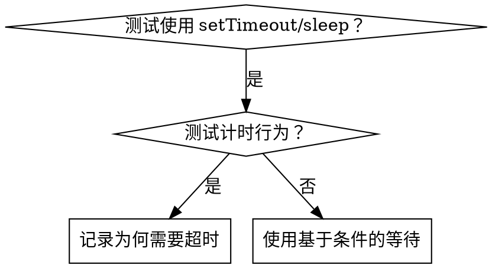

# 基于条件等待

## 概述

不稳定测试常用任意延迟猜测时机。这会制造竞态：测试在快速机器上通过，却在负载或 CI 中失败。

**核心原则：** 等待你真正关心的实际条件，而不是猜测需要多久。

## 何时使用



**使用时机：**

- 测试使用任意延迟（`setTimeout`、`sleep`、`time.sleep()`）

- 测试不稳定（有时通过，负载下失败）

- 并行运行时测试超时

- 等待异步操作完成

**不要使用于：**

- 测试实际计时行为（防抖、节流间隔）

- 使用任意超时时，始终记录原因

## 核心模式

```typescript
await new Promise(r => setTimeout(r, 50));
const result = getResult();
expect(result).toBeDefined();
await waitFor(() => getResult() !== undefined);
const result = getResult();
expect(result).toBeDefined();
```

## 快速模式

| 场景 | 模式 |
|---|---|
| 等待事件 | `waitFor(() => events.find(e => e.type === 'DONE'))` |
| 等待状态 | `waitFor(() => machine.state === 'ready')` |
| 等待数量 | `waitFor(() => items.length >= 5)` |
| 等待文件 | `waitFor(() => fs.existsSync(path))` |
| 复杂条件 | `waitFor(() => obj.ready && obj.value > 10)` |

## 实现

通用轮询函数：

```typescript
async function waitFor<T>(
  condition: () => T | undefined | null | false,
  description: string,
  timeoutMs = 5000
): Promise<T> {
  const startTime = Date.now();

  while (true) {
    const result = condition();
    if (result) return result;

    if (Date.now() - startTime > timeoutMs) {
      throw new Error(`Timeout waiting for ${description} after ${timeoutMs}ms`);
    }

    await new Promise(r => setTimeout(r, 10));
  }
}
```

完整实现及来自真实调试会话的领域辅助函数（`waitForEvent`、`waitForEventCount`、`waitForEventMatch`）见本目录的 `condition-based-waiting-example.ts`。

## 常见错误

**❌ 轮询过快：** `setTimeout(check, 1)`——浪费 CPU
**✅ 修复：** 每 10 毫秒轮询一次

**❌ 没有超时：** 条件永远不满足时会无限循环
**✅ 修复：** 始终包含超时和清晰错误

**❌ 数据过期：** 在循环前缓存状态
**✅ 修复：** 在循环内调用 getter 取得最新数据

## 何时任意超时才是正确的

```typescript
await waitForEvent(manager, 'TOOL_STARTED');
await new Promise(r => setTimeout(r, 200));
```

**要求：**

1. 先等待触发条件

2. 基于已知计时（不是猜测）

3. 注释说明原因

## 实际影响

来自调试会话（2025-10-03）：

- 修复 3 个文件中的 15 个不稳定测试

- 通过率：60% → 100%

- 执行时间：快 40%

- 不再有竞态条件
