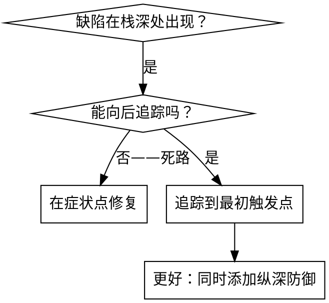
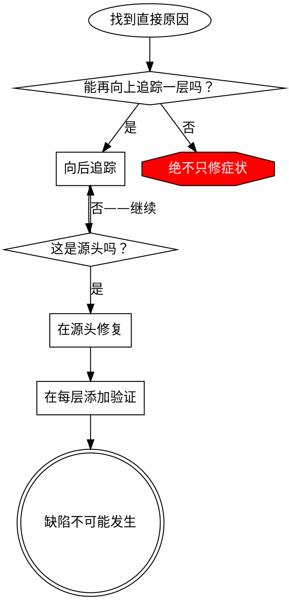

# 根因追踪

## 概述

缺陷经常在调用栈深处显现（在错误目录运行 git init、在错误位置创建文件、用错误路径打开数据库）。直觉是修复错误出现之处，但那只是在处理症状。

**核心原则：** 沿调用链向后追踪，直到找到最初触发点，再从源头修复。

## 何时使用



**使用时机：**

- 错误发生在执行深处（不在入口点）

- 堆栈跟踪显示很长调用链

- 不清楚无效数据来自哪里

- 需要找出哪个测试／代码触发问题

## 追踪流程

### 1. 观察症状

```
Error: git init failed in ~/project/packages/core
```

### 2. 找到直接原因

**什么代码直接造成它？**

```typescript
await execFileAsync('git', ['init'], { cwd: projectDir });
```

### 3. 问：谁调用了它？

```typescript
WorktreeManager.createSessionWorktree(projectDir, sessionId)
  → 由 Session.initializeWorkspace() 调用
  → 由 Session.create() 调用
  → 由 Project.create() 的测试调用
```

### 4. 继续向上追踪

**传入了什么值？**

- `projectDir = ''`（空字符串！）

- 空字符串作为 `cwd` 会解析为 `process.cwd()`

- 那正是源代码目录！

### 5. 找到最初触发点

**空字符串从哪里来？**

```typescript
const context = setupCoreTest();
Project.create('name', context.tempDir);
```

## 添加堆栈跟踪

无法手动追踪时，添加插桩：

```typescript
async function gitInit(directory: string) {
  const stack = new Error().stack;
  console.error('DEBUG git init:', {
    directory,
    cwd: process.cwd(),
    nodeEnv: process.env.NODE_ENV,
    stack,
  });

  await execFileAsync('git', ['init'], { cwd: directory });
}
```

**关键：** 测试中使用 `console.error()`（不要用 logger，它可能不显示）

**运行并捕获：**

```bash
npm test 2>&1 | grep 'DEBUG git init'
```

**分析堆栈跟踪：**

- 查找测试文件名

- 找到触发调用的行号

- 识别模式（同一测试？同一参数？）

## 找出哪个测试造成污染

若测试期间出现某物但不知道来自哪个测试：

使用本目录的二分脚本 `find-polluter.sh`：

```bash
bash ./find-polluter.sh '.git' 'src/**/*.test.ts'
```

逐个运行测试，在第一个污染者停止。用法见脚本。

## 真实示例：空的 projectDir

**症状：** `.git` 创建在 `packages/core/`（源代码）中

**追踪链：**

1. `git init` 在 `process.cwd()` 运行 ← cwd 参数为空

2. WorktreeManager 接收到空 projectDir

3. Session.create() 传入空字符串

4. 测试在 beforeEach 前访问 `context.tempDir`

5. setupCoreTest() 最初返回 `{ tempDir: '' }`

**根因：** 顶层变量初始化时访问了空值

**修复：** 将 tempDir 改为 getter，在 beforeEach 前访问就抛错

**同时添加纵深防御：**

- 第 1 层：Project.create() 验证目录

- 第 2 层：WorkspaceManager 验证非空

- 第 3 层：NODE_ENV 防护拒绝在 tmpdir 之外运行 git init

- 第 4 层：git init 前记录堆栈跟踪

## 关键原则



**绝不只在错误出现之处修复。** 向后追踪找到最初触发点。

## 堆栈跟踪提示

**测试中：** 使用 `console.error()` 而非 logger，logger 可能被抑制
**操作前：** 在危险操作之前记录，而非失败之后
**包含上下文：** 目录、cwd、环境变量、时间戳
**捕获堆栈：** `new Error().stack` 显示完整调用链

## 实际影响

来自 2025-10-03 的调试会话：

- 通过 5 层追踪找到根因

- 在源头修复（getter 验证）

- 添加 4 层防御

- 1847 个测试通过，零污染
