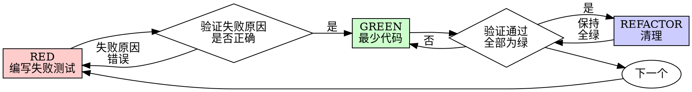

# 测试驱动开发（TDD）

## 概述

先写测试。亲眼看到它失败。编写使其通过的最少代码。

**核心原则：** 如果你没有亲眼看到测试失败，就不知道它是否测试了正确的内容。

**违反规则的字面要求，就是违反规则的精神。**

## 何时使用

**始终使用：**

- 新功能

- 缺陷修复

- 重构

- 行为变更

**例外（询问你的人类伙伴）：**

- 一次性原型

- 生成代码

- 配置文件

在想“就这一次跳过 TDD”？停下。那是合理化借口。

## 铁律

```
没有先失败的测试，就不编写生产代码
```

先写代码后写测试？删除它，重新开始。

**没有例外：**

- 不要把它留作“参考”

- 编写测试时不要“改编”它

- 不要看它

- 删除就是删除

从测试出发重新实现。就这样。

## 红灯—绿灯—重构



### RED——编写失败测试

编写一个最小测试，展示应该发生什么。

```typescript
test('重试失败操作三次', async () => {
  let attempts = 0;
  const operation = () => {
    attempts++;
    if (attempts < 3) throw new Error('fail');
    return 'success';
  };

  const result = await retryOperation(operation);

  expect(result).toBe('success');
  expect(attempts).toBe(3);
});
```

名称清晰，测试真实行为，只测一件事
</Good>

```typescript
test('重试有效', async () => {
  const mock = jest.fn()
    .mockRejectedValueOnce(new Error())
    .mockRejectedValueOnce(new Error())
    .mockResolvedValueOnce('success');
  await retryOperation(mock);
  expect(mock).toHaveBeenCalledTimes(3);
});
```

名称含糊，测试的是 mock，而不是代码
</Bad>

**要求：**

- 一个行为

- 清晰的名称

- 真实代码（除非不可避免，否则不用 mock）

### 验证 RED——亲眼看到失败

**强制要求。绝不能跳过。**

```bash
npm test path/to/test.test.ts
```

确认：

- 测试失败（而不是报错）

- 失败消息符合预期

- 失败原因是功能缺失（而不是拼写错误）

**测试通过？** 你在测试已有行为。修正测试。

**测试报错？** 修复错误，重新运行，直到测试因正确原因失败。

### GREEN——最少代码

编写能让测试通过的最简单代码。

```typescript
async function retryOperation<T>(fn: () => Promise<T>): Promise<T> {
  for (let i = 0; i < 3; i++) {
    try {
      return await fn();
    } catch (e) {
      if (i === 2) throw e;
    }
  }
  throw new Error('unreachable');
}
```

恰好足以通过
</Good>

```typescript
async function retryOperation<T>(
  fn: () => Promise<T>,
  options?: {
    maxRetries?: number;
    backoff?: 'linear' | 'exponential';
    onRetry?: (attempt: number) => void;
  }
): Promise<T> {
}
```

过度设计
</Bad>

不要添加功能、重构其他代码，或作出超出测试范围的“改进”。

### 验证 GREEN——亲眼看到通过

**强制要求。**

```bash
npm test path/to/test.test.ts
```

确认：

- 测试通过

- 其他测试仍然通过

- 输出干净（没有错误或警告）

**测试失败？** 修代码，不是修测试。

**其他测试失败？** 立即修复。

**“其他测试”指项目的测试套件，而不只是你的文件。** 你编写的测试运行全绿，不等于整个套件全绿。在宣布改动完成之前，运行项目的测试命令（直接运行 `pytest`、`npm test`、`cargo test`——以仓库实际使用的为准），即使任务只指定一个测试文件。任务中的范围说明界定交付内容，不界定验证范围。该次运行显示的任何失败——包括并非由你造成的失败——都必须在报告中逐一列名；亲眼看到红色测试滚过屏幕却不提及，就是以遗漏方式伪造报告。

### REFACTOR——清理

只在全绿之后：

- 消除重复

- 改善命名

- 提取辅助函数

保持测试全绿。不要增加行为。

### 重复

为下一项功能编写下一个失败测试。

## 好的测试

| 质量 | 好的做法 | 不好的做法 |
|---------|------|-----|
| **最小** | 只测一件事。名称中有“and”？拆开。 | `test('validates email and domain and whitespace')` |
| **清晰** | 名称描述行为 | `test('test1')` |
| **展示意图** | 展示期望的 API | 掩盖代码应该做什么 |

编写或修改任何测试时，阅读 [writing-good-tests.md](writing-good-tests.md)，了解让测试保持诚实的规则：

- 编写测试之前，说明哪种生产代码改动会让测试失败

- 对真实行为断言，绝不对 mock 行为断言

- 仅用于测试的代码保留在测试工具中，不放进生产类

- mock 某个依赖之前，先理解其副作用

## 常见的自我辩解

| 借口 | 实际情况 |
|--------|---------|
| “太简单，不用测” | 简单代码也会坏。测试只需 30 秒。 |
| “我之后再测” | 事后编写的测试会立即通过，这证明不了任何事。它们可能测试错误内容，测试实现而非行为，或漏掉你忘记的边界情况。你从未看到它失败，因此从未证明它可捕获缺陷。先写测试会强制出现这次失败。 |
| “事后测试能达到相同目标（精神而非仪式）” | 事后测试回答“它做了什么？”；先测试回答“它应该做什么？”事后编写的测试受已有代码影响——你验证的是记得的情况，而不是本会发现的情况。有覆盖率，却没有测试有效的证据。 |
| “已经手动测过了” | 手动测试是临时性的：没有覆盖内容的记录，代码改变时无法重新运行，压力下容易忘记案例。“我试过时能用”不等于全面。自动化测试每次都同样运行。 |
| “删除 X 小时的工作太浪费” | 这是沉没成本谬误——无论如何，那段时间都已花掉。真正的选择是：用 TDD 重写（高信心），还是保留并事后补测试（低信心，可能有缺陷）。保留无法信任的代码才是浪费。 |
| “留作参考，先写测试” | 你会改编它。那是事后测试。删除就是删除。 |
| “需要先探索” | 可以。丢弃探索结果，从 TDD 开始。 |
| “难以测试 = 设计不清楚” | 听测试的。难以测试 = 难以使用。 |
| “TDD 会拖慢我” | TDD 本身就是务实路径：在提交前捕获缺陷、防止回归、让你无惧重构。“务实”捷径意味着在生产环境调试——更慢，而不是更快。 |
| “手动测试更快” | 手动测试无法证明边界情况。每次改动都需重测。 |
| “现有代码没有测试” | 你正在改进它。为现有代码添加测试。 |

## 危险信号——停下并重新开始

- 测试前写代码

- 实现后写测试

- 测试立即通过

- 无法解释测试为何失败

- “以后”再添加测试

- 以“就这一次”自我合理化

- “我已经手动测过了”

- “事后测试达到相同目的”

- “重在精神，不在仪式”

- “留作参考”或“改编现有代码”

- “已经花了 X 小时，删除太浪费”

- “TDD 太教条，我在务实”

- “这次不同，因为……”

**以上都意味着：删除代码，用 TDD 重新开始。**

## 示例：修复缺陷

**缺陷：** 空邮箱被接受

**红色阶段（RED）**

```typescript
test('拒绝空邮箱', async () => {
  const result = await submitForm({ email: '' });
  expect(result.error).toBe('Email required');
});
```

**验证 RED**

```bash
$ npm test
FAIL: expected 'Email required', got undefined
```

**绿色阶段（GREEN）**

```typescript
function submitForm(data: FormData) {
  if (!data.email?.trim()) {
    return { error: 'Email required' };
  }
}
```

**验证 GREEN**

```bash
$ npm test
PASS
```

**REFACTOR**
如有需要，提取适用于多个字段的验证逻辑。

## 验证检查清单

将工作标为完成之前：

- [ ] 每个新函数／方法都有测试

- [ ] 实现前亲眼看到每个测试失败

- [ ] 每个测试都因预期原因失败（功能缺失，而非拼写错误）

- [ ] 编写了让每个测试通过的最少代码

- [ ] 所有测试通过

- [ ] 输出干净（没有错误或警告）

- [ ] 测试使用真实代码（仅在不可避免时使用 mock）

- [ ] 已覆盖边界情况和错误

无法勾选全部？你跳过了 TDD。重新开始。

## 遇到困难时

| 问题 | 解决办法 |
|---------|----------|
| 不知道如何测试 | 写出希望的 API。先写断言。询问你的人类伙伴。 |
| 测试太复杂 | 设计太复杂。简化接口。 |
| 必须 mock 一切 | 代码耦合太强。使用依赖注入。 |
| 测试设置很大 | 提取辅助函数。仍复杂？简化设计。 |

## 与调试结合

发现缺陷？编写复现它的失败测试。遵循 TDD 循环。测试证明修复并防止回归。

绝不要在没有测试的情况下修复缺陷。

## 最终规则

```
生产代码 → 测试已存在且先失败
否则 → 不是 TDD
```

没有你的人类伙伴许可，没有例外。
