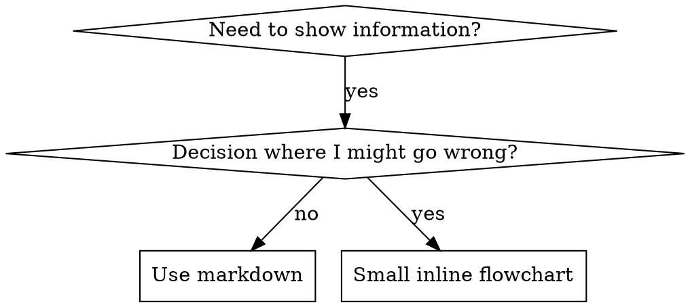

# 技能中的流程图

属于 superpowers:writing-skills。

## 流程图用途



**仅在以下情况用流程图：**

- 不明显的决策点

- 可能过早停止的流程循环

- “何时用 A、何时用 B”的决策

**绝不在以下情况用：**

- 参考资料 → 表格、列表

- 代码示例 → Markdown 代码块

- 线性说明 → 编号列表

- 无语义的标签（step1、helper2）

graphviz 样式规则见本目录 `graphviz-conventions.dot`。

**向人类搭档可视化：** 从此目录运行 writing-skills 中 `render-graphs.js`，把技能流程图渲染为 SVG：

```bash
node ./render-graphs.js ../some-skill           # 分别渲染每张图
node ./render-graphs.js ../some-skill --combine # 合并到一张 SVG
```
